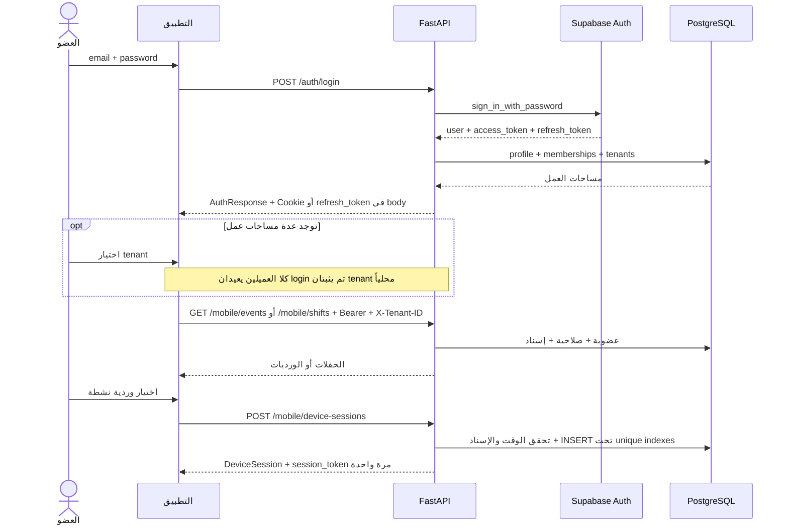
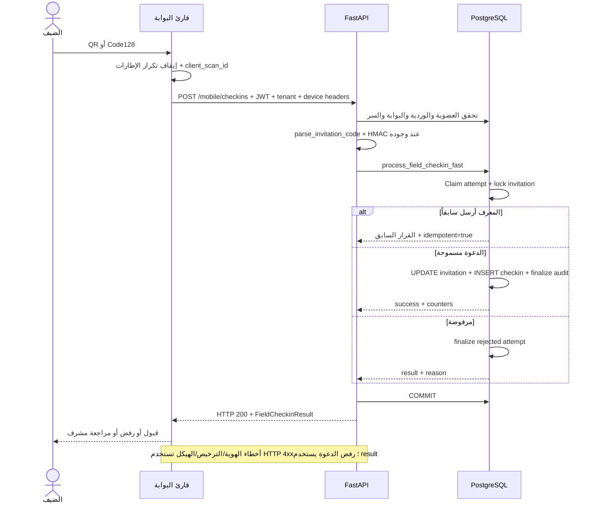
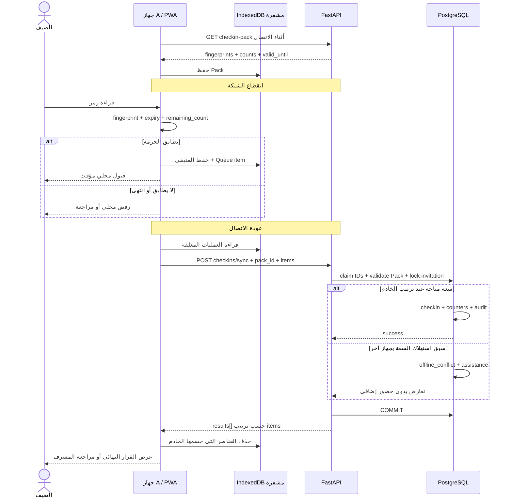
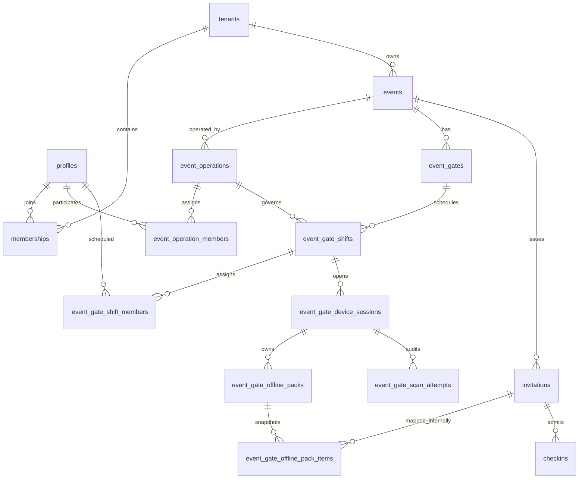

# التوثيق التقني لتطبيق المسح الميداني للدعوات والتذاكر

**تاريخ المراجعة:** 11 أكتوبر 2026. **النطاق:** الكود الموجود في المستودع وقت المراجعة، وليس إثباتاً لحالة نشر الإنتاج. **اللغة:** العربية، مع إبقاء أسماء الحقول والمصطلحات والعقود بالإنجليزية.

## افتراضات

1. المقصود بـ«تطبيق الجوال» هو `field-expo` المبني بـReact Native/Expo، مع توثيق `field-pwa` بوصفه عميلاً آخر للخادم نفسه. ميزات النسختين ليست متطابقة.
2. «الفريق» قد يعني مساحة `organizer` أو سجل `teams`، و«المجموعة» تعني `organizer_team_groups`. لا نفترض أن هذه الكيانات أو صلاحياتها مترادفة.
3. لا يوجد دخول مشترك باسم الفريق في التطبيقين. لكل عضو حساب شخصي؛ تحدد مساحة العمل المختارة وإسنادات التشغيل نطاق دخوله.
4. علامة **منفذ** تعني وجود التنفيذ في الكود. علامة **مقترح** تعني عقداً أو تحسيناً يحتاج تنفيذاً وقراراً، ولا يعني وجود endpoint قابل للاستدعاء.
5. أمثلة JSON تعليمية ببيانات وهمية، وليست رموز دخول أو QR صالحاً. جميع التواريخ المرسلة تستخدم ISO 8601 مع `Z` أو offset؛ عرض تاريخ الحفل يعتمد `events.timezone` لا منطقة جهاز المطور.
6. هذه الوثيقة تغطي دورة المسح كاملة ومسارات الإدارة اللازمة لإسناد الأعضاء والورديات؛ لا تحاول توثيق واجهات الفوترة وتصميم الدعوات والحجوزات العامة كافة.
7. أرقام الحمل المستهدف، مدة السماح بالعمل دون اتصال، مدة الاحتفاظ بالسجلات، وسياسة اعتماد دخول الضيف قبل المزامنة غير معتمدة بعد. المقترحات أدناه ليست إعدادات إنتاج فعلية.
8. مصدر الحقيقة هو ملفات التطبيق ومسارات FastAPI ودوال PostgreSQL، لا الوثائق القديمة في `docs/archive`. مراجعة الكود لا تثبت تطبيق جميع migrations في قاعدة الإنتاج.

### مصادر التنفيذ

| المجال | المصدر |
|---|---|
| واجهة الجوال والتخزين والاتصال | [App.tsx](../field-expo/App.tsx)، [api.ts](../field-expo/src/api.ts)، [storage.ts](../field-expo/src/storage.ts)، [types.ts](../field-expo/src/types.ts) |
| واجهة PWA والعمل دون اتصال | [ScannerConsole.tsx](../field-pwa/src/components/ScannerConsole.tsx)، [localCheckin.ts](../field-pwa/src/lib/localCheckin.ts)، [offlineStore.ts](../field-pwa/src/lib/offlineStore.ts)، [session.ts](../field-pwa/src/lib/session.ts) |
| العقد الميداني | [mobile.py](../app/routes/mobile.py)، [gate_shifts.py](../app/routes/gate_shifts.py)، [checkin.py](../app/routes/checkin.py) |
| الدخول والعزل والصلاحيات | [auth.py](../app/routes/auth.py)، [JWT](../app/auth.py)، [middleware.py](../app/middleware.py)، [gate_shift_service.py](../app/services/gate_shift_service.py)، [permission_service.py](../app/services/permission_service.py) |
| تفسير الرمز والتسجيل الذري | [field_qr_service.py](../app/services/field_qr_service.py)، [field_checkin_service.py](../app/services/field_checkin_service.py)، [barcode_service.py](../app/services/barcode_service.py) |
| نموذج البوابات والحزم وقواعد الدخول | migrations [v46](../supabase/migration_v46_mobile_gate_foundation.sql)، [v47](../supabase/migration_v47_field_qr_and_offline.sql)، [v48](../supabase/migration_v48_fast_field_checkin.sql)، [v51](../supabase/migration_v51_field_checkin_policy.sql) |
| الحدود | [LIMITS_POLICY_AR.md](LIMITS_POLICY_AR.md)، [LIMIT_ERRORS_API.md](LIMIT_ERRORS_API.md)، [subscription_state.py](../app/services/subscription_state.py) |

### فهرس الأقسام

1. [نظرة عامة](#section-1)
2. [تسجيل الدخول للفرق والأعضاء](#section-2)
3. [عرض الاحتفالات](#section-3)
4. [آلية القراءة والمسح](#section-4)
5. [المزامنة اللحظية](#section-5)
6. [العمل والمزامنة بدون إنترنت](#section-6)
7. [توثيق API](#section-7)
8. [نموذج البيانات](#section-8)
9. [الأمان](#section-9)
10. [الحالات الحدّية والأخطاء](#section-10)

<a id="section-1"></a>

## 1. نظرة عامة

### 1.1 الهدف والبنية

يقرأ التطبيق QR وCode128 عند بوابة الحفل، ويربط محاولة الدخول بعضو محدد وجهاز ووردية وبوابة. يتخذ الخادم قرار الدخول، ويسجل الأشخاص المقبولين ونتائج المحاولات لأغراض التشغيل والتدقيق.

المسار المنفذ هو `Client → HTTPS/FastAPI → PostgreSQL`. يستخدم الدخول Supabase Auth، ويطبق Rate Limiting موزعاً عبر Redis. العميل لا يقرأ جداول الدعوات مباشرة من Supabase، ولا يحصل على قائمة عامة بأسماء الضيوف أو الرموز السرية.

| الميزة | `field-expo` | `field-pwa` | الخادم |
|---|---|---|---|
| الدخول الشخصي واختيار مساحة العمل | منفذ | منفذ؛ يرشح `organizer` وعضوية `active` | منفذ |
| قائمة حفلات وملف حفل | منفذ | تعرض الورديات حسب التاريخ؛ لا تستدعي قائمة الحفلات الجديدة | `/mobile/events` و`briefing` منفذان |
| QR/Code128 وقرار الدخول المتصل | منفذ | منفذ | منفذ ذرياً |
| البحث اليدوي والتأكيد والمساعدة | منفذ | منفذ | منفذ بصلاحيات مستقلة |
| تنزيل Pack والتحقق المحلي وQueue | غير منفذ في Expo | منفذ مع فجوات موضحة في القسم 6 | منفذ |
| تجديد `access_token` تلقائياً | غير منفذ؛ `refreshToken` محفوظ فقط | منفذ بعد 401 مرة واحدة | `/auth/refresh` منفذ |
| SSE/WebSocket بين أعضاء الفريق | غير منفذ | غير منفذ | غير منفذ ضمن هذه المسارات |

### 1.2 المستخدمون والصلاحيات

تتكون الصلاحية من أربع طبقات مستقلة: `memberships` في مساحة العمل، ثم RBAC، ثم `event_operation_members`، ثم `event_gate_shift_members`. امتلاك دور `owner` أو `admin` لا يعفي من جلسة جهاز وإسناد وردية للمسح.

| المستخدم/الكيان | دوره الفعلي | ما يستطيع فعله | القيود |
|---|---|---|---|
| فريق التنظيم `organizer tenant` | نطاق تشغيلي وليس هوية دخول | يملك عمليات وأعضاء ومجموعات | كل عملية ينفذها `user_id` شخصي |
| مسؤول المساحة `owner/admin` أو `team_manager` | إدارة حسب RBAC | إدارة الإسنادات والورديات عندما يمتلك صلاحياتها | لا يصبح Scanner تلقائياً |
| مدير العملية `project_manager_id` أو `operation_role=manager` | مسؤول حفل محدد | إسناد أعضاء العملية؛ إدارة الورديات إذا سمحت RBAC | لا يشمل ذلك كل حفلات المنصة |
| عضو الوردية `scanner` | قارئ عند بوابة محددة | عرض إسناداته، بدء جلسة، المسح، طلب المساعدة | يحتاج `checkin.scan` وعضوية العملية والوردية والنافذة الزمنية |
| عضو الوردية `supervisor` | مشرف البوابة | المسح ضمن الشروط نفسها، عرض جلسات الوردية وإلغاؤها | الإلغاء يحتاج `checkin.supervise` أو إدارة الوردية |
| عضو يملك `checkin.search` | بحث محدود | البحث بالاسم/المقعد/الطاولة | جلسة بوابة صالحة؛ لا يتصفح جميع الضيوف |
| عضو يملك `checkin.manual` | تأكيد يدوي | إرسال `invitation_id` من نتائج البحث | يحتاج كذلك `checkin.scan`؛ لا يتجاوز قواعد الدعوة |
| مراقب `viewer` | قراءة حسب RBAC | الشاشات المصرح بها فقط | اسم الدور وحده لا يكفي لإثبات صلاحية المسح |
| مستخدم يملك `checkin.live/view` | مراقبة الحضور | snapshots وسجل حفل مكلف به | ليس اشتراكاً لحظياً، وليس حقاً تلقائياً للـScanner |

الصلاحيات المستخدمة في إدارة الورديات هي **`gate_shifts.view` و`gate_shifts.manage`**. توجد قيمة `gate.shift.manage` في قائمة الصلاحيات المختصرة لـ`/mobile/settings` تختلف في الاسم عن مفاتيح الإدارة؛ لا ينبغي بناء قرار صلاحيات جديد على هذه القيمة قبل توحيدها أو التحقق من alias.

### 1.3 رحلة المستخدم

1. يفتح التطبيق، فتستعاد هوية الدخول وجلسة البوابة المخزنة إن وجدت.
2. يسجل الدخول شخصياً، ويختار مساحة العمل المناسبة عند تعددها.
3. في Expo تظهر الحفلات المسندة له، ثم يفتح ملف الحفل في يومه المحلي. في PWA يختار تاريخاً ووردية.
4. يختار وردية `active` داخل وقتها وعلى بوابة نشطة، ثم يبدأ `DeviceSession`.
5. يمنح إذن الكاميرا، ويقرأ الرمز؛ يثبت التطبيق محاولة المسح ويمنع تكرار إطارات الكاميرا المباشر.
6. يرسل الرمز وعدد الأشخاص إلى `/mobile/checkins`، أو يتحقق محلياً في PWA فقط إذا كانت الحزمة متاحة.
7. يرى القبول أو سبب الرفض أو طلب مراجعة المشرف. يمكنه إضافة أفراد من الدعوة نفسها ضمن المتبقي.
8. يزامن Queue قبل تسليم البوابة، ثم يغلق جلسة الجهاز. تسجيل الخروج من حسابه خطوة مستقلة.

<a id="section-2"></a>

## 2. تسجيل الدخول للفرق والأعضاء

### 2.1 الارتباط بالفريق

اعتماد جهة تنظيم يتم خارج تطبيق المسح. ينضم العضو إلى مساحة الفريق بدعوة `invites` وقبولها بحساب البريد المقصود، أو بإدارة أعضاء المنصة. هذا ينشئ `memberships`؛ الانضمام إلى `teams` ينشئ `team_memberships` ولا يمنح وحده حق دخول حفل.

يُضاف العضو إلى `event_operation_members`، ثم إلى `event_gate_shift_members` مباشرة أو عبر snapshot لمجموعة. عند إسناد مجموعة، تحفظ عضويتها في `event_gate_shift_group_snapshot_members`. تغيير المجموعة لاحقاً لا يعدل تلقائياً أعضاء الوردية القائمة؛ يلزم إجراء صريح عليها.

### 2.2 الدخول خطوة بخطوة

1. `POST /auth/login` مع `email` و`password`، و`tenant_id` اختياري.
2. يتحقق Supabase من الهوية. يحدّث الخادم `profiles.last_login_at` ويحمل مساحات العمل ذات `tenant_status=active/trial`.
3. تعاد `access_token` وقائمة `tenants` و`requires_tenant_selection`. لا توجد عملية `select-tenant` مسجلة؛ اختيار المساحة يتم محلياً وإرسال `X-Tenant-ID` مع الطلبات التالية.
4. يعيد Expo وPWA استدعاء login بعد الاختيار مع `tenant_id`؛ هذا الحقل لا يمثل ترخيصاً من الخادم ولا يغير هوية JWT. كل طلب ميداني يتحقق من العضوية الفعلية.
5. يحفظ Expo `accessToken/refreshToken/tenant` في `SecureStore`. في PWA يحفظ `access_token` و`tenant_id` في `sessionStorage`، بينما `refresh_token` يأتي في Cookie.
6. بعد الدخول يجلب العميل الإسنادات. بدء جلسة البوابة يعيد سراً آخر `session_token` يجب إرساله مع JWT في العمليات الميدانية.



### 2.3 مستويات الجلسة والتوكن

| العنصر | الهدف والتخزين | الصلاحية/الانتهاء |
|---|---|---|
| `access_token` | JWT لهوية العضو؛ `Authorization: Bearer` | يتحقق الخادم من التوقيع و`aud=authenticated` و`role=authenticated` و`exp` و`sub` وissuer إذا مضبوط |
| `refresh_token` | تجديد JWT عبر Supabase | rotation مفعلة في إعدادات المستودع، وreuse interval=10s؛ يجب حفظ الرمز الجديد بعد التجديد |
| `qentry_rt` | HttpOnly Cookie للمتصفح، Path=`/api/v1/auth`، `SameSite=Strict`، `Secure` في الإنتاج | `Max-Age=30 days` حد Cookie، وليس ضماناً لصلاحية جلسة Supabase 30 يوماً |
| `DeviceSession.session_token` | سر بوابة `secrets.token_urlsafe(32)`؛ الخادم يحفظ SHA-256 فقط | مرتبط بـ`user_id/shift_id/gate_id`؛ يرفض عند إغلاق/إلغاء الجلسة أو انتهاء شروط الوردية |
| `device_id` | معرف محلي للجهاز؛ Expo يخزنه في AsyncStorage، وPWA في `localStorage` | معرف تشغيلي وليس Hardware Attestation ولا كلمة مرور |

`jwt_expiry/GOTRUE_JWT_EXP=3600` في إعدادات المستودع، لكن العميل يعتمد `exp` الفعلي؛ لا يفترض أن إعداد الإنتاج مماثل. HS256 مدعوم عند ضبط السر، أو ES256/RS256 عبر JWKS و`kid`؛ تخزن مفاتيح JWKS مؤقتاً لمدة ساعة مع refresh عند دوران المفتاح.

**التجديد المنفذ في PWA:** عند 401 على طلب غير auth يستدعي العميل `/auth/refresh` مع Cookie و`X-Requested-With: qentry`، باستخدام Promise مشتركة لمنع عدة refresh متزامنة، ثم يعيد الطلب مرة واحدة. فشل التجديد يمسح الهوية المحلية. يستخدم PWA `same-origin`؛ استضافة API على origin آخر تحتاج إعداد Cookie/CORS وcredentials صريحاً.

**فجوة Expo:** يحفظ `refreshToken` لكنه لا يستدعي `/auth/refresh` تلقائياً. لا يمكن وصف جلساته بأنها تتجدد حالياً. المقترح هو single-flight refresh، وحفظ زوج التوكن الجديد atomically، وإعادة الطلب نفسه بمعرف `client_scan_id` نفسه.

### 2.4 الانتهاء والخروج وتعدد الأجهزة

- PWA يستدعي `/auth/logout` ثم يمسح الهوية المحلية حتى لو فشل الطلب. لا يقوم logout تلقائياً مقام `/mobile/device-sessions/{id}/close`.
- Expo ينفذ `signOut` محلياً بمسح `SecureStore`؛ لا يستدعي `/auth/logout` ولا يغلق جلسة الجهاز في هذا المسار. قد تبقى جلسة الخادم `active` وتعوق البدء من جهاز آخر.
- `/auth/logout` يحاول إلغاء جلسة Supabase عبر Admin SDK بأسلوب best effort ويبتلع الخطأ. لا يثبت هذا الكود ضمان إلغاء جميع الجلسات؛ JWT صالح قد يبقى مقبولاً حتى `exp` لأن التحقق محلي ولا توجد denylist.
- يسمح الدخول الشخصي من عدة أجهزة على مستوى التطبيق؛ إعدادات Single Session في موفر الهوية ليست مثبتة بهذه المراجعة.
- لجلسة البوابة: Unique index على `(shift_id,user_id)` وآخر على `(shift_id,device_id)` حين `status=active`. هذا منع لكل وردية وليس قيد جهاز وحيد على جميع الورديات.
- محاولة جهاز آخر لنفس العضو والوردية تعيد 409. يلزم handover بإغلاق الجلسة أو إلغائها بواسطة المشرف.
- بعد خمول `last_seen_at` أكثر من **6 ساعات** يمكن بدء جلسة بديلة بعد revoke للجلسة المتعارضة وتسجيل audit. لا يوجد heartbeat دوري للخمول حالياً؛ عدم المسح لا يعني تلقائياً انتهاء العمل.
- لا يبدأ جهاز جديد وردية ولا ينشئ هوية دخول جديدة دون اتصال. الاستعادة المحلية ليست ترخيصاً حديثاً من الخادم.

**مقترح ترتيب الخروج:** مزامنة Queue → إغلاق DeviceSession → auth logout → تنظيف secrets والبيانات حسب سياسة الاحتفاظ. عند تعذر المزامنة يلزم قرار Supervisor يحفظ الأدلة ولا يحذفها بصمت.

<a id="section-3"></a>

## 3. عرض الاحتفالات

### 3.1 الجلب والتخصيص

`GET /mobile/events` يربط `events` بـ`event_operations` و`event_gate_shifts` وعضوية الوردية النشطة. يعيد الحفلات للعضو المختار ضمن `provider_tenant_id` الحالي، لا كل حفلات الفريق ولا كل حفلات حساب الفوترة المرتبط.

يستبعد العمليات `completed/closed/cancelled`، ويقبل ورديات `scheduled/active`. يعيد صفاً لكل `(event_id,operation_id)` مرتباً بـ`start_date,title`. لا يوفر pagination أو query للبحث أو للحالة. النطاق التشغيلي لا يوسع تلقائياً إلى بقية linked workspaces لمجرد اشتراكها في الفوترة.

`GET /mobile/shifts?date=YYYY-MM-DD` يعيد الورديات التي يتقاطع تاريخها المحلي بـ`s.timezone` مع التاريخ المطلوب. إن لم يرسل التاريخ يستخدم `date.today()` على خادم التطبيق؛ **مقترح**: إلزام تاريخ التشغيل الصريح لتجنب اختلاف timezone الخادم.

### 3.2 ملف الحفل والبوابات

`GET /mobile/events/{event_id}/briefing` متاح فقط في اليوم المحلي للحفل أو نطاق أيامه بين `start_date/end_date`، ويعيد:

| المجموعة | الحقول |
|---|---|
| تعريف الحفل | `event_id,title,title_ar,description` |
| الوقت والمكان | `start_date,end_date,timezone,venue_name,venue_name_ar` |
| الإتاحة | `is_available_today` |
| الأعداد | `statistics.total_invitations,vip_invitations,normal_invitations,expected_guests,checked_in_guests` |
| الإسنادات الشخصية | `shifts[]`، مع البوابة والوقت والدور و`can_start` |

الأعداد في briefing تستبعد `is_registration` وحالات `revoked/expired/declined`. `expected_guests` مجموع `guest_count`، و`checked_in_guests` مجموع `checkin_count`. لا تستبعد الاستعلامات بالضرورة `expires_at` المنقضي أو `rsvp_status=declined` إذا لم تتغير `status`؛ لذا ليست الأرقام تعريفاً نهائياً لكل من يسمح له بالدخول.

### 3.3 الحالات والبحث

| وصف الواجهة المقترح | تعريف زمني مقترح | السلوك الحالي |
|---|---|---|
| قادم | التاريخ المحلي قبل أول يوم للحفل | يمكن عرضه في قائمة Expo؛ briefing وبدء الجلسة ممنوعان |
| جارٍ/اليوم | داخل أيام الحفل | فتح briefing ممكن؛ المسح يحتاج وردية `active` و`starts_at ≤ now < ends_at` |
| منتهٍ | بعد آخر يوم | لا يبدأ session؛ الحفلات المكتملة تشغيلياً مستبعدة من القائمة |
| ملغى | `events.status=cancelled` | إلغاء lifecycle يحدث العمليات المرتبطة؛ القائمة تستبعد العمليات الملغاة |

حالات قاعدة الحدث هي `draft/published/active/completed/cancelled`. قائمة mobile لا تعيد `events.status` ولا تفرضها صراحة؛ `is_available_today` مؤشر تاريخ لا دليل جاهزية. لا ينبغي تحويله إلى «جارٍ» بمفهوم الحالة التشغيلية دون حقل صريح.

Expo يقدم قائمة وPull-to-refresh وملفاً؛ لا ينفذ بحثاً عاماً أو فلترة حالة مستقلة. PWA يفلتر الورديات بالتاريخ. **مقترح:** إضافة `status,date_from,date_to,query,cursor` لمسار قائمة ميداني، مع إبقاء التخصيص بالخادم وإظهار «آخر تحديث».

<a id="section-4"></a>

## 4. آلية القراءة والمسح

### 4.1 من الكاميرا إلى القرار

1. Expo يستخدم `expo-camera` وPWA يستخدم ZXing، مع QR وCode128 فقط. القراءة تعطي النص الخام؛ لا يتخذ Camera SDK قرار صلاحية الدعوة.
2. Expo يحجب تكرار الرمز خلال 1400ms ويستخدم submit lock؛ PWA يؤخر قراءات الكاميرا ويعطلها أثناء النتيجة. هذه حماية UX وليست حماية قاعدة البيانات.
3. يرسل العميل `raw_code` و`entry_count` و`client_scan_id` و`client_captured_at` و`scan_method`. `event_id/gate_id` لا تؤخذ من الرمز أو body؛ تحسم من DeviceSession.
4. يثبت الخادم JWT وtenant وRBAC، ثم session secret والعضو والعملية والوردية والبوابة والوقت.
5. يفسر الرمز إلى token canonical، ويتحقق من HMAC إذا كان signed، أو من صيغة legacy المقبولة.
6. يستدعي `process_field_checkin_fast`، الذي يحجز محاولة عبر unique `(device_session_id,client_scan_id)` ثم يقفل صف الدعوة `FOR UPDATE OF i`.
7. تطبق قواعد event/gate/status/expiry/RSVP/count/reentry داخل المعاملة. القبول يحدّث الدعوة وينشئ `checkins` ويختم `event_gate_scan_attempts`.
8. ينفذ المسار `commit` قبل الاستجابة. إعادة المعرف نفسه تعيد القرار السابق بـ`idempotent=true` ولا تضيف دخولاً.



### 4.2 صيغ الرمز

| `code_format` | الصيغة المقبولة | التحقق |
|---|---|---|
| `qentry_v1` | `qentry:v1:<invitation UUID>:<token>:<32 hex HMAC>` | HMAC + مطابقة UUID مع الدعوة المحلولة بالخادم |
| `legacy_signed` | `<invitation UUID>:<token>:<32 hex HMAC>` | HMAC نفسه |
| `legacy_url` | `https://<APP_URL host>/i/<token>` | نطاق APP_URL، وlocalhost/127.0.0.1 مسموحان في parser الحالي، ثم lookup |
| `legacy_token` | `[A-Za-z0-9_-]{8,512}` | lookup بالخادم؛ بلا توقيع إلزامي |

المدخل يحد إلى 4096 حرفاً، وتمنع control characters في parser. روابط التسجيل العامة أو URLs العشوائية غير مقبولة. توقيع malformed قد ينتج `invalid` قبل lookup. حفظ تنسيقات legacy يعني أن وجود HMAC ليس شرطاً لجميع المسوحات المقبولة حالياً.

### 4.3 نتائج الدخول والواجهة

هذه نتائج Domain تعاد عادة بـHTTP 200. لا ينبغي للعميل تفسير 200 وحده بأنه قبول.

| `result` | السبب | الرسالة الحالية/ما يراه المستخدم | الإجراء |
|---|---|---|---|
| `success` | قبول العدد المطلوب | «تم قبول الدعوة وتسجيل الدخول.»؛ اسم الضيف عند القبول المتصل، الفئة والمتبقي | دخول العدد المقبول |
| `already_checked_in` | استهلاك كامل العدد وreentry غير مسموح | «استُخدمت الدعوة بالكامل سابقاً.»؛ Warning | مراجعة مشرف، لا دخول إضافي |
| `capacity_exceeded` | العدد أكبر من المتبقي أو أكبر من `guest_count` | «العدد المطلوب أكبر من المتبقي في هذه الدعوة.» | تخفيض العدد أو طلب مراجعة |
| `revoked` | الدعوة ملغاة | «الدعوة ملغاة.» | رفض |
| `expired` | `status=expired` أو `expires_at ≤ now` | «انتهت صلاحية الدعوة.» | رفض |
| `declined` | status أو `rsvp_status=declined` | «تم رفض الحضور لهذه الدعوة.» | رفض |
| `rsvp_required` | metadata.require_rsvp مفعّل وRSVP غير accepted | «تتطلب هذه الدعوة تأكيد الحضور (RSVP) قبل الدخول.» | تأكيد عبر المسار المناسب، ثم محاولة جديدة |
| `wrong_event` | الرمز صحيح لكن حدثه مختلف | «هذه الدعوة تخص حفلاً آخر.» | توجيه لحفله |
| `wrong_gate` | فئة غير مسموحة أو gate_id مختلف | «فئة هذه الدعوة غير مسموحة من هذه البوابة.» | توجيه للبوابة المناسبة |
| `registration_code` | `is_registration=true` | «هذا رمز تسجيل عام وليس دعوة دخول.» | لا يعتمد للدخول حتى لو approved |
| `invalid` | صيغة/توقيع/lookup غير صالح | «تعذر التحقق من رمز الدعوة.» | إعادة القراءة أو البحث المحدود |
| `invalid_entry_count` | حماية العدد في دالة SQL | «عدد الداخلين غير صالح.» | تصحيح العدد؛ API عادة يرفضه أولاً بـ422 |
| `offline_conflict` | عدم كفاية السعة أثناء sync | «تعارضت هذه الدعوة أثناء المزامنة؛ تم اعتماد المسح الأول فقط.» | طلب مساعدة أوتوماتيكي عند اكتشافه في الخادم |
| `pack_invalid` | الحزمة منتهية/ملغاة أو version مختلف | «حزمة العمل لم تعد صالحة للمزامنة.» | مراجعة الأدلة؛ لا يضيف حضوراً |
| `processing` | إعادة محاولة قيد المعالجة | «تتم معالجة محاولة المسح.» | انتظار وإعادة بنفس ID؛ ليس قبولاً |

نتائج `offline/error` التي يعرضها Expo عند انقطاع الشبكة أو HTTP exception **محلية للواجهة**، وليست من نتائج دالة SQL. في PWA اللون أخضر للقبول، أصفر لـ`requires_assistance`، وأحمر للبقية؛ Expo يستخدم success/warning/error مع Haptics. قائمة المحاولات الأخيرة في PWA تشمل آخر 8 على الجهاز وليست سجل الفريق.

### 4.4 الأشخاص وإعادة الدخول

`guest_count` هو عدد أفراد الدعوة، و`entry_count` هو عدد الداخلين في محاولة واحدة. يمكن قبول شخص ثم بقية المجموعة بعمليات منفصلة. `remaining_count=max(guest_count-checkin_count,0)`.

إذا `events.allow_reentry=true` يسمح SQL بمسح جديد حتى بعد نفاد المتبقي، بشرط ألا يتجاوز `entry_count` حجم المجموعة. يزيد `checkin_count` في كل دخول، وقد يتجاوز `guest_count`. لذلك مجموع `checkin_count` يقيس **حركات دخول الأشخاص** حين تفعّل reentry، وليس عدد الأشخاص الفريدين أو الإشغال الحالي. لا يوجد خروج مقابل يضمن حساب الإشغال.

<a id="section-5"></a>

## 5. المزامنة اللحظية

### 5.1 الوضع المنفذ

تسجيل المسح متزامن وذري في PostgreSQL، لكن بث القرار لبقية الأجهزة غير منفذ. `/checkin/live/{event_id}` و`briefing` هما GET snapshots. واجهات الإدارة قد تحدثها دورياً؛ تطبيق Expo يحدث ملف الحفل بالتحميل/التحديث، وليس باشتراك live. لا توجد عقود `scan.created` أو WebSocket فعلية في `mobile.py`.

`/checkin/live` يحسب **سجلات دعوات** status=checked_in؛ `briefing` يجمع **أشخاص/حركات** checkin_count. الأول قد يشمل تسجيلات عامة أو declined ضمن `total_valid` لأن استعلامه يستبعد revoked/expired فقط. لا يجوز عرض الرقمين تحت التسمية نفسها.

### 5.2 التصميم المقترح: SSE للقراءة، REST للأوامر

نقترح SSE لبث تحديثات الحضور من الخادم إلى العملاء؛ المسح والمساعدة وsync تبقى POST requests. هذه حاجة أحادية الاتجاه غالباً، بخلاف WebSocket الذي يناسب إذا تقرر لاحقاً وجود تحكم متبادل مستمر. SSE يقدم حقول `id/event/data/retry` وإعادة اتصال؛ مرجعه [MDN](https://developer.mozilla.org/en-US/docs/Web/API/Server-sent_events/Using_server-sent_events) و[WHATWG](https://html.spec.whatwg.org/dev/server-sent-events.html).

**اختيارنا المعماري مقترح، وليس ضمان توافق تلقائي مع React Native.** يجب اختبار عميل SSE على Expo المستهدف في foreground/background. لا تسمح واجهة Browser EventSource القياسية بتمرير custom Authorization header؛ لهذا التطبيق نختار SSE client عبر authenticated fetch streaming، أو مكتبة مدققة تدعم headers في native. لا يوضع JWT أو device secret في query string. إذا تعذر دعم streaming موثوق، نستخدم WebSocket بعقد authorization مكافئ، أو polling مؤقتاً.

مسار **مقترح وغير منفذ**: `GET /api/v1/mobile/events/{event_id}/stream`، مع `Accept: text/event-stream` وJWT وtenant وdevice headers؛ نطاق Scanner بوابته، ونطاق المشرف يحدد صراحة. لا نفتح قناة جميع أحداث الحفل لمجرد membership في المساحة.

### 5.3 الاعتمادية وتحديث العدادات

- يكتب `checkins` و`outbox event` في المعاملة نفسها، ثم ينشر Worker بعد commit. نشر الرسالة قبل commit أو publish فقط إلى Redis Pub/Sub قد يفقد أو يبث حضوراً متراجعاً.
- يحدد `revision` متزايد لكل نطاق؛ delivery تكون at-least-once. العميل يتجاهل المكرر أو القديم ويستبدل القيم المطلقة، ولا يزيد counters محلياً لكل event بلا deduplication.
- ترسل snapshots بعد الاتصال مع cursor متسق مع البيانات، ثم deltas. يجب تسلسل تخصيص revision ونشره حتى لا يتخطى replay حدثاً التزم متأخراً.
- تدقيق admission يبقى في PostgreSQL. replay log يحتفظ لمدة مقترحة 24 ساعة تحتاج قراراً. Redis Streams/سجل دائم يصلح للنقل، وPub/Sub للإيقاظ فقط.
- reconnect: تأخير exponential 1/2/4/8 حتى 30s مع jitter، heartbeat مقترح كل 15s، ثم replay من `Last-Event-ID`. بعد background يعاد snapshot إذا ظهرت فجوة.
- 401 → refresh واحد ثم reconnect؛ 403 أو `session.revoked` → إيقاف المسح والاشتراك؛ 429 → احترام Retry-After. إذا انتهت فترة replay يرسل `resync.required` ويجلب snapshot.
- لا يعني SSE أن الأجهزة المنفصلة ترى شيئاً. UI يعرض «آخر تحديث» وحالة `connected/reconnecting/offline` ويمنع تقديم counters القديمة على أنها لحظية.

### 5.4 عقد الأحداث المقترح

الغلاف لكل حدث persistent؛ جميع UUIDs strings، `revision` string عددية لتجنب حدود JavaScript، و`occurred_at` وقت خادم UTC.

```json
{
  "schema_version": 1,
  "event_id": "11111111-1111-4111-8111-111111111111",
  "gate_id": "22222222-2222-4222-8222-222222222222",
  "revision": "1042",
  "occurred_at": "2026-10-11T16:15:00Z",
  "type": "attendance.updated",
  "data": {
    "admissions_total": 237,
    "checked_in_invitations": 180,
    "gate_admissions_total": 82,
    "by_class": { "vip": 40, "normal": 197 },
    "unique_guests": null
  }
}
```

| `type` المقترح | من يرسل/يتلقى | `data` والأنواع | المعنى |
|---|---|---|---|
| `attendance.snapshot` | الخادم → المشترك المخول | `admissions_total:int,checked_in_invitations:int,gate_admissions_total:int,by_class:{vip:int,normal:int},unique_guests:null` | snapshot عند الاتصال؛ لا ندعي عدد ضيوف فريدين غير محسوب |
| `attendance.updated` | Worker → أجهزة النطاق | الحقول نفسها؛ `source_checkin_id:UUID` اختياري | تحديث بعد commit؛ لا أسماء ولا token |
| `session.revoked` | الخادم → الجهاز المقصود | `device_session_id:UUID,reason:string` | تعطيل فوري حين الاتصال |
| `shift.updated` | الخادم → أجهزة الوردية | `shift_id:UUID,status:string,starts_at:datetime,ends_at:datetime` | تغيّر نافذة العمل؛ يعاد التحقق |
| `event.cancelled` | الخادم → إسنادات الحفل | `reason:string أو null,effective_at:datetime` | إيقاف التشغيل والاحتفاظ بالعمليات للمراجعة |
| `assistance.created` | الخادم → Supervisor | `request_id:UUID,shift_id:UUID,assistance_type:string,status:string` | طلب مساعدة بدون PII |
| `resync.required` | الخادم → العميل | `reason:string,snapshot_url:string` | cursor لم يعد قابلاً للاستئناف |
| `heartbeat` | الخادم → العميل | `server_time:datetime` | رسالة غير persistent بلا cursor جديد |

المقترح لا يرسل Client events داخل SSE. العميل يرسل scan عبر `/mobile/checkins`، ومساعدة عبر `/mobile/assistance`، وbatch عبر `/mobile/checkins/sync`. يستأنف الاشتراك بإرسال `Last-Event-ID`. ACK فردي لكل event غير مطلوب؛ cursor محلي يكفي للقراءة.

مثال wire format المقترح:

```text
id: 1042
event: attendance.updated
retry: 3000
data: {"schema_version":1,"event_id":"11111111-1111-4111-8111-111111111111","gate_id":"22222222-2222-4222-8222-222222222222","revision":"1042","occurred_at":"2026-10-11T16:15:00Z","type":"attendance.updated","data":{"admissions_total":237,"checked_in_invitations":180,"gate_admissions_total":82,"by_class":{"vip":40,"normal":197},"unique_guests":null}}

```

<a id="section-6"></a>

## 6. العمل والمزامنة بدون إنترنت

### 6.1 الحالة والتحميل المسبق

الميزة منفذة في PWA والخادم، **غير منفذة في Expo**. رسالة Expo تشير إلى ضرورة تنزيل حزمة وتفعيل الوضع، لكن API client وشاشاته الحالية لا تنفذ download/queue/sync. لا توجد SQLite للضيوف أو Queue native في الإصدار الحالي.

يتطلب تنزيل الحزمة الاتصال والهوية وجلسة بوابة فعالة. `GET /mobile/checkin-pack/{shift_id}` ينشئ snapshot وينتهي عند `shift.ends_at`، ويعيد الحزمة active السابقة إن وجدت. زر «تحديث حزمة العمل» في PWA يعيد تنزيل snapshot نفسها؛ لا يضمن بيانات أحدث ولا version جديدة. الحزمة الحالية تستخدم `version=1`.

| البيانات المحملة | السبب | لا تحمل |
|---|---|---|
| `pack_id,shift_id,gate_id,version,valid_from,valid_until` | ربط الجهاز والوردية والفترة | قائمة أسماء أو هواتف أو بريد |
| `fingerprint_salt` | SHA-256 مختلف لكل Pack | HMAC secret أو token الأصلي في Pack |
| `items[].code_fingerprint` | مطابقة الرمز المقروء | `invitation_id` الداخلي |
| `ticket_class,allowed_count,remaining_count,expires_at` | الفئة والسعة والصلاحية المحلية | تاريخ حضور شامل أو بيانات فريق كامل |

تستبعد الحزمة registrations وrevoked/expired/declined، وتستبعد **كل** دعوة `require_rsvp=true` حتى إذا كان RSVP مقبولاً، لتجنب قبول محلي بناءً على حالة RSVP قابلة للتغيير. يسمح فقط بالدعوات المنتمية للحفل والفئات والبوابة.

### 6.2 التحقق المحلي المنفذ

1. يتحقق `localCheckin` من `valid_until` بساعة الجهاز.
2. يطبع الرمز إلى token باستخدام regex لصيغ qentry/legacy URL/legacy token.
3. يحسب `SHA-256(fingerprint_salt + ':' + token)` ويبحث في عناصر الحزمة.
4. يتحقق من `expires_at` ومن `entry_count <= remaining_count`، ثم ينقص المتبقي المحلي.
5. يحفظ Pack المشفرة وينشئ Queue record مشفراً عند النجاح فقط؛ يعرض «تم قبول الدعوة محلياً وستتم مزامنتها عند عودة الشبكة».

**ما لا يتحقق منه محلياً:** HMAC لا يتحقق منه PWA، وhostname في URL لا يطابق APP_URL كما يفعل الخادم، و`valid_from` لا يفحص، وclock drift غير مصحح. الاعتماد المحلي قائم على وجود fingerprint لtoken في snapshot؛ ليس تحققاً تشفيرياً مكافئاً للتحقق المتصل. لا يعطى العميل HMAC key. يمكن مستقبلاً استخدام توقيع asymmetric لحزمة/رمز offline بمفتاح تحقق عام.

PWA لا تدعم reentry محلياً بعد نفاد `remaining_count`، رغم إمكانية قبولها متصلاً. رمز صالح لحفل/بوابة أخرى غير موجود بالحزمة يعطي `invalid` محلياً؛ لا توجد معلومات كافية لتصنيف wrong_event مقابل wrong_gate.

### 6.3 طابور العمليات والمزامنة

كل عملية تحمل `client_scan_id,captured_at,raw_code,entry_count,pack_version,scan_method` وترتبط بـ`pack_id`. هنا يحتوي Queue على الرمز المقروء **مشفراً**؛ لا يصح تعميم أن الجهاز لا يخزن raw QR مطلقاً. Pack نفسها تحتوي fingerprints فقط.

عند عودة الاتصال يعمل PWA على sync أو عبر زر «مزامنة الآن». يرسل batch إلى `/mobile/checkins/sync`. الخادم يعيد نتائج **بالترتيب نفسه**، ولا يعيد `client_scan_id` لكل result في العقد الحالي. يعيد فحص الحزمة والمطابقة ثم قواعد الدعوة الحالية وقفل الصف؛ نجاحه ينقص Pack item على الخادم.



المخطط يصف المسار المقصود؛ حفظ Pack وQueue في العميل الحالي عمليتان منفصلتان وليستا معاملة IndexedDB واحدة، وهي فجوة موضحة أدناه.

### 6.4 حل التعارضات: من يعتمد؟

الخادم يعتمد **أول عملية صحيحة تحصل على قفل الدعوة وتلتزم بالمعاملة** ضمن السعة المتاحة، وليس أول timestamp على الجهاز ولا بالضرورة أول request وصل socket. `captured_at` دليل تدقيق فقط، ويمكن التلاعب به أو اختلاف ساعة الجهاز.

مثال: دعوة لشخص واحد وPack على جهازين A وB. كلاهما يقبل محلياً أثناء الانقطاع. إذا مزامنة B التزمت أولاً، يسجل B حضوراً؛ A تعاد `offline_conflict`. لو rollback لـB، لا تستهلك السعة ويستطيع A النجاح. لدعوة أربعة أشخاص قد تنجح عمليتان مجموعهما ≤4؛ لا يرفض كل مسح ثانٍ تلقائياً. إذا reentry مفعلة فإن منع التكرار بمعناه التجاري يحتاج سياسة مختلفة.

لا توجد طريقة لتضمين قرار جهاز غير متصل في قرار جهاز آخر غير متصل دون وسيط مشترك. قد يكون شخصان قد دخلا فعلياً قبل اكتشاف التعارض؛ رفض سجل إضافي بعد sync لا يخرج شخصاً دخل. **القرار المطلوب:** هل القبول المحلي إذن دخول مؤقت فعلي، أم نوقف الدخول عند الانقطاع؟ بديل أقوى هو LAN coordinator أو حجز سعة لكل جهاز/بوابة بحيث لا تتداخل، مع إعادة توزيع موثق.

### 6.5 فجوات حالية تحتاج معالجة قبل اعتماد Offline واسع

| الفجوة المستخرجة من الكود | أثرها | الإجراء المقترح |
|---|---|---|
| Queue غير مقسمة إلى chunks؛ API تقبل 100 فقط | أكثر من 100 محاولة تعطي 422 ويظل الطابور معلقاً | chunks ≤100، lock sync، retry/backoff |
| ترتيب Queue يعتمد `getAll` على المفتاح الذي يحتوي UUID | ترتيب الأجهزة المحلي ليس مضموناً بحسب captured_at | `local_sequence` monotonic؛ الحسم بين الأجهزة يبقى بالخادم |
| Pack save وQueue write غير ذريين | انقطاع بينهما ينقص السعة دون عملية قابلة للرفع | transaction واحدة للرصيد والـoutbox المحلي |
| مسار Online الفاشل بشبكة غير محسومة يولد Queue ID جديداً | قد يكون الخادم قبل الطلب السابق؛ الجديد يظهر تعارضاً أو يضيف دخولاً عند reentry | توليد ID مرة واحدة قبل الإرسال والمحافظة عليه online/offline |
| sync يحذف كل المرسل عند HTTP 200 بلا تصنيف terminal/retry | قد يسقط `processing` أو دليل تعارض محلي بعد العرض | ACK لكل ID؛ حالات pending/acked/review؛ حفظ قرارات المشرف |
| sync effect يعاود عند تغير `syncing` بلا backoff واضح | خطر retry متكرر عند فشل دائم | Retry-After، backoff، إيقاف على 403/422 حتى معالجة السبب |
| Pack مستقرة ولا تتحدث بعد Online scans | المتبقي المحلي قديم عند فقد الشبكة | تحديث الحالة المحلية أو delta/reservation موثوق؛ لا اعتبار snapshot منعاً عالمياً للتكرار |
| فحص صلاحية Pack يستخدم وقت المزامنة لا captured_at | عمليات صحيحة محلياً قبل نهاية الوردية ترفع بعدها لا تضيف حضوراً | اعتماد grace period أو review-only صريح يحتاج قراراً |
| stale-session fallback لا يفرض `valid_pack=false` بنفسه | إزالة عضوية العملية/تعطيلها أو إلغاء العملية قد تبقي Pack active؛ قد تستمر sync عبر fallback | fail closed لأي session غير authorized؛ تدقيق فقط مع منع routine admission |
| لا يوجد إشعار revoke لجهاز منفصل | استمرار قبول snapshot حتى انتهاءها | offline lease قصيرة؛ إبطال chained لكل الحالات؛ UI يوضح عدم التحديث |
| local parser لا يفحص التوقيع/hostname | قد يقبل محلياً ما يرفضه الخادم لاحقاً | توحيد parsing والتوقيع العام أو ضوابط محلية واضحة |

**تمييز لازم:** إلغاء DeviceSession أو إكمال/إلغاء shift يفعّل trigger لإبطال Packs فعلاً. أما فشل `_require_field_session` لأسباب أخرى فلا يوجد ضمان مماثل في fallback الحالي. هذه ملاحظة مراجعة ساكنة تحتاج regression tests، وليست ادعاء اختبار استغلال على الإنتاج.

<a id="section-7"></a>

## 7. توثيق API

### 7.1 قواعد مشتركة

الـBase path هو **`/api/v1`**. جميع المسارات في هذا القسم تذكره كاملاً. JSON بـUTF-8، وUUID نص، و`datetime` بصيغة ISO 8601. لا توجد session secrets في body أو query لمسارات المسح الحديثة.

الحصر أدناه يشمل جميع endpoints الحالية في `/mobile` و`/gate-shifts`، بالإضافة إلى APIs المصادقة والإسناد والمراقبة اللازمة للعميل أو مشرفه. إدارة التسجيل الأولي وإصدار الضيوف والدعوات وطلبات اعتماد الجهة خارج هذا العقد.

| مجموعة Headers | الحقول | الاستخدام |
|---|---|---|
| `H0` | `Accept: application/json`؛ `Content-Type: application/json` عند body | Login/Refresh |
| `H1` | H0 + `Authorization: Bearer <access_token>` | Logout/Me وقبول دعوة العضوية |
| `H2` | H1 + `X-Tenant-ID: <UUID>` | APIs مرتبطة بمساحة العمل |
| `H3` | H2 + `X-Field-Device-Session: <UUID>` + `X-Field-Device-Token: <secret>` | المسح والبحث وPack وSync والمساعدة |

`X-Field-Device-Token` طوله 20–512 حرفاً في validator. تظهر device headers اختيارية في OpenAPI لأنها تتحقق داخل الخدمة؛ **هي مطلوبة تشغيلياً** لكل H3. بدائل tenant resolution موجودة عبر slug/domain، لكن عقد العملاء الحالي يستخدم `X-Tenant-ID` صراحة.

للطلب المتصفح: لا يقرأ JavaScript `qentry_rt`. للـnative: `X-Refresh-Transport: body` على Login وRefresh إذا أردت الرمز الجديد في JSON. `X-Requested-With: qentry` إلزامي لتجديد Cookie وليس عند إرسال refresh_token بالـbody.

### 7.2 الأخطاء المشتركة وأمثلتها

كل endpoint مصادق قد يتلقى أخطاء طبقات middleware قبل منطق المسار؛ تبقى إضافات المسار مذكورة معه. محتوى الرسالة قد يختلف وفق السبب، وبعض الرسائل الحالية بالإنجليزية. لم نحولها في هذه المهمة إلى عقد عربي جديد.

| المرجع | HTTP | السبب ومثال Response |
|---|---|---|
| `E400` | 400 | tenant غير محدد أو business input غير صالح: `{"detail":"لم يتم تحديد المستأجر. أرسل X-Tenant-ID أو X-Tenant-Slug في الهيدر."}` |
| `E401` | 401 | JWT منتهي/غير صالح: `{"detail":"Invalid authentication token"}`؛ في middleware قد تكون `Invalid authorization token` |
| `E403` | 403 | نقص الصلاحية: `{"detail":"ليس لديك صلاحية: checkin.scan"}`؛ أو tenant/عضوية/session مرفوضة |
| `E403_SESSION` | 403 | جلسة ميدانية غير صالحة: `{"detail":"جلسة الجهاز أو وردية البوابة غير صالحة لهذه العملية"}` |
| `E404` | 404 | المورد غير متاح بالنطاق: `{"detail":"الوردية غير موجودة"}` |
| `E409` | 409 | تعارض جلسة/إسناد/حالة: `{"detail":"لديك جلسة جهاز فعّالة لهذه الوردية. اطلب من مشرف البوابة إلغاءها قبل البدء من جهاز آخر."}` |
| `E422` | 422 | فشل schema: `{"detail":[{"type":"missing","loc":["body","client_scan_id"],"msg":"Field required","input":{}}]}`؛ فحص business قد يعيد detail string |
| `E429_RATE` | 429 | `{"detail":{"code":"RATE_LIMIT_EXCEEDED","limit":120,"retry_after":60,"message":"تم تجاوز حد الطلبات المسموح به. يرجى المحاولة لاحقاً."}}`؛ Header `Retry-After: 60` |
| `E429_PLAN` | 429 | إسناد عضو يتجاوز حصة إدارة: `{"detail":{"code":"PLAN_LIMIT_EXCEEDED","limit_key":"seats_max","current":5,"limit":5,"requested":1,"message":"تم الوصول إلى حد المقاعد."}}`؛ مثال للقيم والشكل، النص الفعلي يولد بالخادم |
| `E402` | 402 | وضع الاشتراك المنتهي read-only: `{"detail":{"code":"SUBSCRIPTION_EXPIRED","plan_name":"starter","ended_at":"2026-10-10T00:00:00Z","message":"انتهى اشتراكك. المساحة في وضع العرض فقط حتى يُفعَّل التجديد."}}`؛ الرسالة هنا مثال، و`X-Subscription-State: expired` |
| `E503` | 503 | limiter غير متاح: `{"detail":"خدمة الحماية من الإساءة غير متاحة مؤقتاً."}`؛ أو موفر الهوية: `{"detail":"Identity provider is temporarily unavailable"}` |
| `E500` | 500 | خطأ داخلي: `{"detail":"حدث خطأ داخلي غير متوقع","request_id":"aaaaaaaa-aaaa-4aaa-8aaa-aaaaaaaaaaaa"}` |
| `E410` | 410 | المسار القديم متقاعد: `{"detail":"تم إيقاف مسار المسح القديم لحماية قواعد RSVP وإعادة الدخول. استخدم POST /api/v1/mobile/checkins مع جلسة جهاز نشطة ومعرّف client_scan_id."}` |

أخطاء HTTPBearer عند غياب Authorization قد تكون 401 أو 403 بحسب إصدار dependency؛ العميل يعاملها كفشل مصادقة قبل أي قبول. أخطاء JSON غير صحيح أو UUID/enum/length/count تعيد E422. 500/503 و429 ممكنة لجميع المجموعات. `E402` ممكنة للكتابة tenant-scoped بحسب `expired_read_only/expired_allow_checkin`؛ لا تطبق على auth exempt.

**Domain rejection مثال:** HTTP 200 مع result=`wrong_event` يعني رفض دخول، وليس API error. أمثلة بقية النتائج موضحة في القسم 4؛ جميعها تستخدم schema التالية:

| حقل `FieldCheckinResult` | النوع | المعنى |
|---|---|---|
| `result` | string | الحالة في جدول النتائج |
| `message` | string | رسالة للمستخدم |
| `invitation_id` | UUID أو null | الدعوة المحلولة، لا يدخل Pack |
| `guest_name` | string أو null | اسم عند نجاح online؛ null للرفض وsync/replay |
| `ticket_class` | string أو null | الفئة |
| `event_title` | string أو null | الحفل المحلول |
| `checkin_count` | integer | عداد الخادم النهائي أو المحلي الموصوف |
| `guest_count` | integer | السعة الأصلية |
| `remaining_count` | integer | المتبقي |
| `entry_count` | integer | عدد المحاولة |
| `requires_assistance` | boolean | اقتراح مراجعة، لا يمنح override |
| `code_format` | string أو null | صيغة الرمز؛ بعض replays تعيد null |
| `idempotent` | boolean | أعيدت نتيجة attempt نفسه |

```json
{"result":"wrong_event","message":"هذه الدعوة تخص حفلاً آخر.","invitation_id":"77777777-7777-4777-8777-777777777777","guest_name":null,"ticket_class":"normal","event_title":"حفل آخر","checkin_count":0,"guest_count":1,"remaining_count":1,"entry_count":1,"requires_assistance":false,"code_format":"qentry_v1","idempotent":false}
```

### 7.3 المصادقة

| Method | Endpoint | الغرض | Headers |
|---|---|---|---|
| POST | `/api/v1/auth/login` | دخول شخصي واكتشاف مساحات العمل | H0؛ `X-Refresh-Transport: body` للـnative |
| POST | `/api/v1/auth/refresh` | تجديد وتدوير جلسة الدخول | H0؛ Cookie + `X-Requested-With: qentry`، أو body token؛ `X-Refresh-Transport: body` للـnative |
| POST | `/api/v1/auth/logout` | طلب الخروج ومسح Cookie وتسجيل audit | H1 |
| GET | `/api/v1/auth/me` | استعادة الملف الشخصي والمساحات والصلاحيات | H1؛ `X-Tenant-ID` اختياري لاسترجاع permissions |

#### `POST /api/v1/auth/login`

**الغرض:** دخول شخصي واكتشاف مساحات العمل. **المخول:** عام؛ لا يحتاج Bearer. **Headers:** H0؛ `X-Refresh-Transport: body` للـnative.

| الحقل | الموضع | النوع | إلزامي | القيود/الافتراضي |
|---|---|---|---|---|
| email | body | email | نعم | — |
| password | body | string | نعم | — |
| tenant_id | body | string أو null | لا | — |

`tenant_id` اختياري string وليس UUID validator هنا؛ لا يعتمد كترخيص. Cookie تضبط في الاستجابة. عند تعدد المساحات تعاد القائمة نفسها مع `requires_tenant_selection=true`.

**Response نجاح: HTTP 200.**

```json
{
  "message": "تم تسجيل الدخول بنجاح",
  "user_id": "66666666-6666-4666-8666-666666666666",
  "access_token": "<access_token>",
  "refresh_token": "<refresh_token: native only>",
  "tenants": [
    {
      "tenant_id": "55555555-5555-4555-8555-555555555555",
      "slug": "demo-team",
      "name": "فريق التشغيل",
      "tenant_status": "active",
      "plan": "starter",
      "role": "member",
      "membership_status": "active",
      "workspace_type": "organizer",
      "linked_tenant_id": null
    }
  ],
  "requires_tenant_selection": false
}
```

**الأخطاء المحتملة:** E422 وE429_RATE/E503/E500. 401 بيانات الدخول غير صحيحة؛ 503 تعذر تجهيز مساحة العمل؛ E422 وE429_RATE. الأمثلة العامة لكل HTTP code في 7.2؛ رفض الدعوة لا يحول إلى HTTP error.

#### `POST /api/v1/auth/refresh`

**الغرض:** تجديد وتدوير جلسة الدخول. **المخول:** حامل refresh_token صالح. **Headers:** H0؛ Cookie + `X-Requested-With: qentry`، أو body token؛ `X-Refresh-Transport: body` للـnative.

| الحقل | الموضع | النوع | إلزامي | القيود/الافتراضي |
|---|---|---|---|---|
| refresh_token | body | string أو null | لا | — |

Body نفسه اختياري. إذا غاب token من body يستخدم Cookie. يجب استبدال token القديم بالجديد؛ المتصفح يستقبل refresh_token=null في JSON.

**Response نجاح: HTTP 200.**

```json
{
  "message": "تم تحديث التوكن بنجاح",
  "user_id": "66666666-6666-4666-8666-666666666666",
  "access_token": "<new access_token>",
  "refresh_token": "<new refresh_token: native only>",
  "tenants": null,
  "requires_tenant_selection": false
}
```

**الأخطاء المحتملة:** E422 وE429_RATE/E503/E500. 401 رمز غير موجود/منتهٍ/غير صالح؛ 403 Header CSRF غير صحيح؛ E422 وE429_RATE. الأمثلة العامة لكل HTTP code في 7.2؛ رفض الدعوة لا يحول إلى HTTP error.

#### `POST /api/v1/auth/logout`

**الغرض:** طلب الخروج ومسح Cookie وتسجيل audit. **المخول:** عضو مصادق. **Headers:** H1.

**Request:** لا body أو parameters إضافية.

لا body. الإلغاء لدى موفر الهوية best effort؛ لا يغلق DeviceSession تلقائياً.

**Response نجاح: HTTP 200.**

```json
{
  "message": "تم تسجيل الخروج بنجاح",
  "user_id": null,
  "access_token": null,
  "refresh_token": null,
  "tenants": null,
  "requires_tenant_selection": false
}
```

**الأخطاء المحتملة:** E422 وE429_RATE/E503/E500. E401/E403 عند غياب المصادقة؛ E429_RATE/E503/E500. الأمثلة العامة لكل HTTP code في 7.2؛ رفض الدعوة لا يحول إلى HTTP error.

#### `GET /api/v1/auth/me`

**الغرض:** استعادة الملف الشخصي والمساحات والصلاحيات. **المخول:** عضو مصادق. **Headers:** H1؛ `X-Tenant-ID` اختياري لاسترجاع permissions.

**Request:** لا body أو parameters إضافية.

لا Query/body. توجد fallback responses عند تعذر تحميل profile/tenants؛ القائمة الفارغة لا تثبت دائماً انعدام العضوية.

**Response نجاح: HTTP 200.**

```json
{
  "user_id": "66666666-6666-4666-8666-666666666666",
  "email": "member@example.test",
  "full_name": "عضو تجريبي",
  "avatar_url": null,
  "phone": null,
  "is_staff": false,
  "status": "active",
  "email_verified_at": "2026-10-11T16:00:00Z",
  "last_login_at": "2026-10-11T16:00:00Z",
  "created_at": "2026-10-11T16:00:00Z",
  "tenants": [
    {
      "tenant_id": "55555555-5555-4555-8555-555555555555",
      "slug": "demo-team",
      "name": "فريق التشغيل",
      "tenant_status": "active",
      "plan": "starter",
      "role": "member",
      "membership_status": "active",
      "workspace_type": "organizer",
      "linked_tenant_id": null
    }
  ],
  "permissions": [
    "checkin.scan"
  ]
}
```

**الأخطاء المحتملة:** E422 وE429_RATE/E503/E500. E401/E403؛ E429_RATE/E503/E500. الأمثلة العامة لكل HTTP code في 7.2؛ رفض الدعوة لا يحول إلى HTTP error.

### 7.4 الفرق والأعضاء والإسنادات الإدارية

| Method | Endpoint | الغرض | Headers |
|---|---|---|---|
| GET | `/api/v1/teams` | قائمة الفرق في مساحة العمل | H2 |
| GET | `/api/v1/teams/{team_id}` | بيانات فريق داخل النطاق | H2 |
| GET | `/api/v1/teams/{team_id}/members` | أعضاء سجل الفريق | H2 |
| POST | `/api/v1/teams/{team_id}/members` | إضافة عضو نشط أو تعديل role داخل الفريق | H2 |
| DELETE | `/api/v1/teams/{team_id}/members/{user_id}` | إزالة عضوية فريق | H2 |
| POST | `/api/v1/invites` | دعوة بريدية لعضوية مساحة العمل | H2 |
| GET | `/api/v1/invites` | دعوات عضوية المساحة | H2 |
| POST | `/api/v1/invites/accept/{token}` | قبول دعوة العضوية بحساب البريد المقصود | H1 |
| DELETE | `/api/v1/invites/{invite_id}` | إلغاء دعوة pending وتحرير حجز المقعد | H2 |
| POST | `/api/v1/operations/{operation_id}/members` | إضافة/تعديل عضو العملية | H2 |
| DELETE | `/api/v1/operations/{operation_id}/members/{member_id}` | إزالة عضو من العملية | H2 |
| GET | `/api/v1/gate-shifts` | قائمة الورديات التشغيلية للحفل | H2 |
| POST | `/api/v1/gate-shifts` | إنشاء وردية ومشاركة Supervisor | H2 |
| GET | `/api/v1/gate-shifts/{shift_id}` | تفصيل الوردية وأعضائها والمجموعات المسندة | H2 |
| PATCH | `/api/v1/gate-shifts/{shift_id}` | تعديل الوقت أو المشرف أو حالة الوردية | H2 |
| POST | `/api/v1/gate-shifts/{shift_id}/members` | إسناد مباشر لعضو بالوردية | H2 |
| POST | `/api/v1/gate-shifts/{shift_id}/groups` | إسناد snapshot لمجموعة تشغيلية | H2 |
| DELETE | `/api/v1/gate-shifts/{shift_id}/members/{member_id}` | إلغاء إسناد العضو وإبطال جلساته | H2 |
| GET | `/api/v1/gate-shifts/{shift_id}/device-sessions` | عرض جلسات أجهزة الوردية للتسليم | H2 |
| POST | `/api/v1/gate-shifts/{shift_id}/device-sessions/{session_id}/revoke` | إبطال جلسة جهاز مع سبب مدقق | H2 |

#### `GET /api/v1/teams`

**الغرض:** قائمة الفرق في مساحة العمل. **المخول:** `teams.view`. **Headers:** H2.

**Request:** لا body أو parameters إضافية.

**Response نجاح: HTTP 200.**

```json
[
  {
    "id": "55555555-5555-4555-8555-555555555555",
    "tenant_id": "55555555-5555-4555-8555-555555555555",
    "name": "فريق التشغيل",
    "description": null,
    "color": "#6366f1",
    "is_active": true,
    "created_by": "66666666-6666-4666-8666-666666666666",
    "created_at": "2026-10-11T16:00:00Z",
    "updated_at": "2026-10-11T16:00:00Z",
    "members_count": 1,
    "leader_name": "قائد تجريبي"
  }
]
```

**الأخطاء المحتملة:** E400 للـtenant، E401/E403 للمصادقة والصلاحيات، E422 للتحقق، E429_RATE/E503/E500.  الأمثلة العامة لكل HTTP code في 7.2؛ رفض الدعوة لا يحول إلى HTTP error.

#### `GET /api/v1/teams/{team_id}`

**الغرض:** بيانات فريق داخل النطاق. **المخول:** `teams.view`. **Headers:** H2.

| الحقل | الموضع | النوع | إلزامي | القيود/الافتراضي |
|---|---|---|---|---|
| team_id | path | uuid | نعم | — |

**Response نجاح: HTTP 200.**

```json
{
  "id": "55555555-5555-4555-8555-555555555555",
  "tenant_id": "55555555-5555-4555-8555-555555555555",
  "name": "فريق التشغيل",
  "description": null,
  "color": "#6366f1",
  "is_active": true,
  "created_by": "66666666-6666-4666-8666-666666666666",
  "created_at": "2026-10-11T16:00:00Z",
  "updated_at": "2026-10-11T16:00:00Z",
  "members_count": 1,
  "leader_name": "قائد تجريبي"
}
```

**الأخطاء المحتملة:** E400 للـtenant، E401/E403 للمصادقة والصلاحيات، E422 للتحقق، E429_RATE/E503/E500. 404 الفريق غير موجود. الأمثلة العامة لكل HTTP code في 7.2؛ رفض الدعوة لا يحول إلى HTTP error.

#### `GET /api/v1/teams/{team_id}/members`

**الغرض:** أعضاء سجل الفريق. **المخول:** `teams.view`. **Headers:** H2.

| الحقل | الموضع | النوع | إلزامي | القيود/الافتراضي |
|---|---|---|---|---|
| team_id | path | uuid | نعم | — |

إذا لا توجد صفوف مطابقة، قد يعيد [] حتى للفريق غير الموجود؛ لا يثبت أن الفريق موجود.

**Response نجاح: HTTP 200.**

```json
[
  {
    "id": "99999999-9999-4999-8999-999999999999",
    "team_id": "55555555-5555-4555-8555-555555555555",
    "user_id": "66666666-6666-4666-8666-666666666666",
    "role": "member",
    "joined_at": "2026-10-11T16:00:00Z",
    "full_name": "عضو تجريبي",
    "avatar_url": null
  }
]
```

**الأخطاء المحتملة:** E400 للـtenant، E401/E403 للمصادقة والصلاحيات، E422 للتحقق، E429_RATE/E503/E500.  الأمثلة العامة لكل HTTP code في 7.2؛ رفض الدعوة لا يحول إلى HTTP error.

#### `POST /api/v1/teams/{team_id}/members`

**الغرض:** إضافة عضو نشط أو تعديل role داخل الفريق. **المخول:** `teams.manage`. **Headers:** H2.

| الحقل | الموضع | النوع | إلزامي | القيود/الافتراضي |
|---|---|---|---|---|
| team_id | path | uuid | نعم | — |
| user_id | body | uuid | نعم | — |
| role | body | `member` / `team_lead` | لا | افتراضي: `"member"` |

عضوية الفريق لا تنشئ عضوية العملية أو الوردية.

**Response نجاح: HTTP 201.**

```json
{
  "id": "99999999-9999-4999-8999-999999999999",
  "team_id": "55555555-5555-4555-8555-555555555555",
  "user_id": "66666666-6666-4666-8666-666666666666",
  "role": "member",
  "joined_at": "2026-10-11T16:00:00Z",
  "full_name": "عضو تجريبي",
  "avatar_url": null
}
```

**الأخطاء المحتملة:** E400 للـtenant، E401/E403 للمصادقة والصلاحيات، E422 للتحقق، E429_RATE/E503/E500. E402 للكتابة عند تفعيل read-only وانعدام استثناء المسح. 404 الفريق غير موجود؛ 400 المستخدم ليس عضواً نشطاً في المؤسسة؛ E429_PLAN لحصة team_members_per_team. الأمثلة العامة لكل HTTP code في 7.2؛ رفض الدعوة لا يحول إلى HTTP error.

#### `DELETE /api/v1/teams/{team_id}/members/{user_id}`

**الغرض:** إزالة عضوية فريق. **المخول:** `teams.manage`. **Headers:** H2.

| الحقل | الموضع | النوع | إلزامي | القيود/الافتراضي |
|---|---|---|---|---|
| team_id | path | uuid | نعم | — |
| user_id | path | uuid | نعم | — |

النجاح 204 بلا JSON. لا يفترض حذف snapshot وردية سبق إسنادها.

**Response نجاح: HTTP 204.**

بلا body؛ لا ينتظر العميل JSON بعد 204.

**الأخطاء المحتملة:** E400 للـtenant، E401/E403 للمصادقة والصلاحيات، E422 للتحقق، E429_RATE/E503/E500. E402 للكتابة عند تفعيل read-only وانعدام استثناء المسح. 404 الفريق/العضو غير موجود؛ 409 لا يمكن إزالة قائد الفريق الوحيد. الأمثلة العامة لكل HTTP code في 7.2؛ رفض الدعوة لا يحول إلى HTTP error.

#### `POST /api/v1/invites`

**الغرض:** دعوة بريدية لعضوية مساحة العمل. **المخول:** `members.manage`؛ منح admin يحتاج owner. **Headers:** H2.

| الحقل | الموضع | النوع | إلزامي | القيود/الافتراضي |
|---|---|---|---|---|
| email | body | email | نعم | — |
| role | body | InviteMembershipRole | لا | — |

role الافتراضي member، والقيم admin/member/viewer؛ لا owner عبر الدعوة.

**Response نجاح: HTTP 201.**

```json
{
  "id": "88888888-8888-4888-8888-888888888888",
  "tenant_id": "55555555-5555-4555-8555-555555555555",
  "email": "member@example.test",
  "role": "member",
  "status": "pending",
  "invited_by": "66666666-6666-4666-8666-666666666666",
  "expires_at": "2026-10-18T16:00:00Z",
  "accepted_at": null,
  "created_at": "2026-10-11T16:00:00Z"
}
```

**الأخطاء المحتملة:** E400 للـtenant، E401/E403 للمصادقة والصلاحيات، E422 للتحقق، E429_RATE/E503/E500. E402 للكتابة عند تفعيل read-only وانعدام استثناء المسح. 409 عضو موجود أو دعوة pending؛ E429_PLAN للمقاعد؛ 500 فشل إنشاء الدعوة. الأمثلة العامة لكل HTTP code في 7.2؛ رفض الدعوة لا يحول إلى HTTP error.

#### `GET /api/v1/invites`

**الغرض:** دعوات عضوية المساحة. **المخول:** `members.view`. **Headers:** H2.

**Request:** لا body أو parameters إضافية.

**Response نجاح: HTTP 200.**

```json
[
  {
    "id": "88888888-8888-4888-8888-888888888888",
    "tenant_id": "55555555-5555-4555-8555-555555555555",
    "email": "member@example.test",
    "role": "member",
    "status": "pending",
    "invited_by": "66666666-6666-4666-8666-666666666666",
    "expires_at": "2026-10-18T16:00:00Z",
    "accepted_at": null,
    "created_at": "2026-10-11T16:00:00Z"
  }
]
```

**الأخطاء المحتملة:** E400 للـtenant، E401/E403 للمصادقة والصلاحيات، E422 للتحقق، E429_RATE/E503/E500.  الأمثلة العامة لكل HTTP code في 7.2؛ رفض الدعوة لا يحول إلى HTTP error.

#### `POST /api/v1/invites/accept/{token}`

**الغرض:** قبول دعوة العضوية بحساب البريد المقصود. **المخول:** حساب مصادق يطابق البريد؛ لا tenant header مطلوب. **Headers:** H1.

| الحقل | الموضع | النوع | إلزامي | القيود/الافتراضي |
|---|---|---|---|---|
| token | path | string | نعم | — |

token مساري string؛ لا body. يتحول invite pending إلى accepted مرة واحدة تحت row lock. لا يضيف إسناد حفل تلقائياً.

**Response نجاح: HTTP 200.**

```json
{
  "message": "تم قبول الدعوة بنجاح",
  "tenant_id": "55555555-5555-4555-8555-555555555555",
  "role": "member"
}
```

**الأخطاء المحتملة:** E422 وE429_RATE/E503/E500. 404 Invite not found؛ 400 Invite has expired أو حالة غير pending؛ 403 اختلاف البريد؛ 409 عضوية موجودة أو دعوة owner قديمة. الأمثلة العامة لكل HTTP code في 7.2؛ رفض الدعوة لا يحول إلى HTTP error.

#### `DELETE /api/v1/invites/{invite_id}`

**الغرض:** إلغاء دعوة pending وتحرير حجز المقعد. **المخول:** `members.manage`. **Headers:** H2.

| الحقل | الموضع | النوع | إلزامي | القيود/الافتراضي |
|---|---|---|---|---|
| invite_id | path | uuid | نعم | — |

**Response نجاح: HTTP 204.**

بلا body؛ لا ينتظر العميل JSON بعد 204.

**الأخطاء المحتملة:** E400 للـtenant، E401/E403 للمصادقة والصلاحيات، E422 للتحقق، E429_RATE/E503/E500. E402 للكتابة عند تفعيل read-only وانعدام استثناء المسح. 404 Pending invite not found؛ النجاح 204 بلا JSON. الأمثلة العامة لكل HTTP code في 7.2؛ رفض الدعوة لا يحول إلى HTTP error.

#### `POST /api/v1/operations/{operation_id}/members`

**الغرض:** إضافة/تعديل عضو العملية. **المخول:** `operations.members` + operation_role=manager. **Headers:** H2.

| الحقل | الموضع | النوع | إلزامي | القيود/الافتراضي |
|---|---|---|---|---|
| operation_id | path | uuid | نعم | — |
| user_id | body | uuid | نعم | — |
| role | body | `manager` / `lead` / `member` / `viewer` | نعم | — |
| group_id | body | uuid أو null | لا | — |

role إلزامي manager/lead/member/viewer؛ group_id اختياري UUID. النجاح 204 بلا body.

**Response نجاح: HTTP 204.**

بلا body؛ لا ينتظر العميل JSON بعد 204.

**الأخطاء المحتملة:** E400 للـtenant، E401/E403 للمصادقة والصلاحيات، E422 للتحقق، E429_RATE/E503/E500. E402 للكتابة عند تفعيل read-only وانعدام استثناء المسح. 400 عضو غير نشط أو group خارج المساحة؛ 403 غير المدير؛ 409 محاولة إزالة دور المدير دون بديل؛ E429_PLAN عند إضافة عضو جديد. الأمثلة العامة لكل HTTP code في 7.2؛ رفض الدعوة لا يحول إلى HTTP error.

#### `DELETE /api/v1/operations/{operation_id}/members/{member_id}`

**الغرض:** إزالة عضو من العملية. **المخول:** `operations.members` + operation_role=manager. **Headers:** H2.

| الحقل | الموضع | النوع | إلزامي | القيود/الافتراضي |
|---|---|---|---|---|
| operation_id | path | uuid | نعم | — |
| member_id | path | uuid | نعم | — |

لا يضمن هذا المسار منفرداً revoke لسجلات DeviceSession/Pack؛ active session check يرفض العضوية التشغيلية المفقودة لكن stale sync يحتاج تقوية.

**Response نجاح: HTTP 204.**

بلا body؛ لا ينتظر العميل JSON بعد 204.

**الأخطاء المحتملة:** E400 للـtenant، E401/E403 للمصادقة والصلاحيات، E422 للتحقق، E429_RATE/E503/E500. E402 للكتابة عند تفعيل read-only وانعدام استثناء المسح. 400 لا يمكن إزالة مدير المشروع الأساسي؛ 404 العضو غير موجود؛ 403 غير المدير. الأمثلة العامة لكل HTTP code في 7.2؛ رفض الدعوة لا يحول إلى HTTP error.

#### `GET /api/v1/gate-shifts`

**الغرض:** قائمة الورديات التشغيلية للحفل. **المخول:** `gate_shifts.view` + provider-event access. **Headers:** H2.

| الحقل | الموضع | النوع | إلزامي | القيود/الافتراضي |
|---|---|---|---|---|
| event_id | query | uuid | نعم | — |
| gate_id | query | uuid أو null | لا | — |

event_id Query مطلوب؛ gate_id Query اختياري. يشمل scheduled/active/completed/cancelled بعكس /mobile/shifts.

**Response نجاح: HTTP 200.**

```json
[
  {
    "id": "33333333-3333-4333-8333-333333333333",
    "event_id": "11111111-1111-4111-8111-111111111111",
    "gate_id": "22222222-2222-4222-8222-222222222222",
    "operation_id": "44444444-4444-4444-8444-444444444444",
    "starts_at": "2026-10-11T16:00:00Z",
    "ends_at": "2026-10-11T21:00:00Z",
    "timezone": "Asia/Riyadh",
    "status": "active",
    "supervisor_user_id": "66666666-6666-4666-8666-666666666666",
    "created_by": "66666666-6666-4666-8666-666666666666",
    "activated_at": "2026-10-11T16:00:00Z",
    "closed_at": null,
    "cancellation_reason": null,
    "created_at": "2026-10-11T16:00:00Z",
    "updated_at": "2026-10-11T16:00:00Z",
    "gate_name": "Main gate",
    "gate_name_ar": "البوابة الرئيسية",
    "supervisor_name": "مشرف تجريبي",
    "assigned_members": 1,
    "scanners": 1,
    "supervisors": 0
  }
]
```

**الأخطاء المحتملة:** E400 للـtenant، E401/E403 للمصادقة والصلاحيات، E422 للتحقق، E429_RATE/E503/E500.  الأمثلة العامة لكل HTTP code في 7.2؛ رفض الدعوة لا يحول إلى HTTP error.

#### `POST /api/v1/gate-shifts`

**الغرض:** إنشاء وردية ومشاركة Supervisor. **المخول:** `gate_shifts.manage` + provider-event access. **Headers:** H2.

| الحقل | الموضع | النوع | إلزامي | القيود/الافتراضي |
|---|---|---|---|---|
| event_id | body | uuid | نعم | — |
| gate_id | body | uuid | نعم | — |
| operation_id | body | uuid | نعم | — |
| starts_at | body | date-time | نعم | — |
| ends_at | body | date-time | نعم | — |
| timezone | body | string | لا | أقل طول: `2`؛ أقصى طول: `64`؛ افتراضي: `"Asia/Riyadh"` |
| supervisor_user_id | body | uuid | نعم | — |

starts_at/ends_at بtimezone وends_at>starts_at. timezone الافتراضي Asia/Riyadh.

**Response نجاح: HTTP 201.**

```json
{
  "id": "33333333-3333-4333-8333-333333333333",
  "event_id": "11111111-1111-4111-8111-111111111111",
  "gate_id": "22222222-2222-4222-8222-222222222222",
  "operation_id": "44444444-4444-4444-8444-444444444444",
  "starts_at": "2026-10-11T16:00:00Z",
  "ends_at": "2026-10-11T21:00:00Z",
  "timezone": "Asia/Riyadh",
  "status": "scheduled",
  "supervisor_user_id": "66666666-6666-4666-8666-666666666666",
  "created_by": "66666666-6666-4666-8666-666666666666",
  "activated_at": null,
  "closed_at": null,
  "cancellation_reason": null,
  "created_at": "2026-10-11T16:00:00Z",
  "updated_at": "2026-10-11T16:00:00Z"
}
```

**الأخطاء المحتملة:** E400 للـtenant، E401/E403 للمصادقة والصلاحيات، E422 للتحقق، E429_RATE/E503/E500. E402 للكتابة عند تفعيل read-only وانعدام استثناء المسح. 422 وقت أو عملية أو صلاحية supervisor غير ملائمة؛ 409 تعارض gate/operation/overlap تحت DB constraints. الأمثلة العامة لكل HTTP code في 7.2؛ رفض الدعوة لا يحول إلى HTTP error.

#### `GET /api/v1/gate-shifts/{shift_id}`

**الغرض:** تفصيل الوردية وأعضائها والمجموعات المسندة. **المخول:** `gate_shifts.view` + provider-event access. **Headers:** H2.

| الحقل | الموضع | النوع | إلزامي | القيود/الافتراضي |
|---|---|---|---|---|
| shift_id | path | uuid | نعم | — |

**Response نجاح: HTTP 200.**

```json
{
  "shift": {
    "id": "33333333-3333-4333-8333-333333333333",
    "event_id": "11111111-1111-4111-8111-111111111111",
    "gate_id": "22222222-2222-4222-8222-222222222222",
    "operation_id": "44444444-4444-4444-8444-444444444444",
    "starts_at": "2026-10-11T16:00:00Z",
    "ends_at": "2026-10-11T21:00:00Z",
    "timezone": "Asia/Riyadh",
    "status": "active",
    "supervisor_user_id": "66666666-6666-4666-8666-666666666666",
    "created_by": "66666666-6666-4666-8666-666666666666",
    "activated_at": "2026-10-11T16:00:00Z",
    "closed_at": null,
    "cancellation_reason": null,
    "created_at": "2026-10-11T16:00:00Z",
    "updated_at": "2026-10-11T16:00:00Z",
    "gate_name": "Main gate",
    "gate_name_ar": "البوابة الرئيسية",
    "provider_tenant_id": "55555555-5555-4555-8555-555555555555",
    "project_manager_id": "66666666-6666-4666-8666-666666666666",
    "operation_status": "in_progress",
    "event_title": "Demo celebration",
    "event_title_ar": "الحفل التجريبي"
  },
  "members": [
    {
      "user_id": "66666666-6666-4666-8666-666666666666",
      "role": "scanner",
      "assignment_source": "direct",
      "source_group_id": null,
      "conflict_override_reason": null,
      "is_active": true,
      "assigned_at": "2026-10-11T16:00:00Z",
      "full_name": "عضو تجريبي",
      "avatar_url": null
    }
  ],
  "groups": []
}
```

**الأخطاء المحتملة:** E400 للـtenant، E401/E403 للمصادقة والصلاحيات، E422 للتحقق، E429_RATE/E503/E500. 404 الوردية غير موجودة؛ 403 لا يوجد وصول للحفل. الأمثلة العامة لكل HTTP code في 7.2؛ رفض الدعوة لا يحول إلى HTTP error.

#### `PATCH /api/v1/gate-shifts/{shift_id}`

**الغرض:** تعديل الوقت أو المشرف أو حالة الوردية. **المخول:** `gate_shifts.manage` + provider-event access. **Headers:** H2.

| الحقل | الموضع | النوع | إلزامي | القيود/الافتراضي |
|---|---|---|---|---|
| shift_id | path | uuid | نعم | — |
| starts_at | body | date-time أو null | لا | — |
| ends_at | body | date-time أو null | لا | — |
| timezone | body | string أو null | لا | أقل طول: `2`؛ أقصى طول: `64` |
| supervisor_user_id | body | uuid أو null | لا | — |
| status | body | `scheduled` / `active` / `completed` / `cancelled` أو null | لا | — |
| cancellation_reason | body | string أو null | لا | أقصى طول: `1000` |

كل body fields اختيارية، لكن لا ترسل null للوقت/الحالة/المشرف. scheduled→active/cancelled؛ active→completed/cancelled؛ terminal تبقى على نفسها. completed/cancelled تغلق جلسات الجهاز وتبطل Packs.

**Response نجاح: HTTP 200.**

```json
{
  "id": "33333333-3333-4333-8333-333333333333",
  "event_id": "11111111-1111-4111-8111-111111111111",
  "gate_id": "22222222-2222-4222-8222-222222222222",
  "operation_id": "44444444-4444-4444-8444-444444444444",
  "starts_at": "2026-10-11T16:00:00Z",
  "ends_at": "2026-10-11T21:00:00Z",
  "timezone": "Asia/Riyadh",
  "status": "active",
  "supervisor_user_id": "66666666-6666-4666-8666-666666666666",
  "created_by": "66666666-6666-4666-8666-666666666666",
  "activated_at": "2026-10-11T16:00:00Z",
  "closed_at": null,
  "cancellation_reason": null,
  "created_at": "2026-10-11T16:00:00Z",
  "updated_at": "2026-10-11T16:00:00Z"
}
```

**الأخطاء المحتملة:** E400 للـtenant، E401/E403 للمصادقة والصلاحيات، E422 للتحقق، E429_RATE/E503/E500. E402 للكتابة عند تفعيل read-only وانعدام استثناء المسح. 404 غير موجودة؛ 422 الوقت/سبب الإلغاء؛ 409 انتقال غير مسموح أو activation خارج النافذة أو DB conflict. الأمثلة العامة لكل HTTP code في 7.2؛ رفض الدعوة لا يحول إلى HTTP error.

#### `POST /api/v1/gate-shifts/{shift_id}/members`

**الغرض:** إسناد مباشر لعضو بالوردية. **المخول:** `gate_shifts.manage` + provider-event access. **Headers:** H2.

| الحقل | الموضع | النوع | إلزامي | القيود/الافتراضي |
|---|---|---|---|---|
| shift_id | path | uuid | نعم | — |
| user_id | body | uuid | نعم | — |
| role | body | `scanner` / `supervisor` | لا | افتراضي: `"scanner"` |
| conflict_override_reason | body | string أو null | لا | أقل طول: `3`؛ أقصى طول: `1000` |

يحتاج target checkin.scan؛ supervisor يحتاج checkin.supervise. target عضو العملية، والتعارض الزمني يحتاج conflict_override_reason موثقاً.

**Response نجاح: HTTP 201.**

```json
{
  "shift_id": "33333333-3333-4333-8333-333333333333",
  "user_id": "66666666-6666-4666-8666-666666666666",
  "role": "scanner",
  "assignment_source": "direct",
  "source_group_id": null,
  "assigned_by": "66666666-6666-4666-8666-666666666666",
  "conflict_override_reason": null,
  "is_active": true,
  "assigned_at": "2026-10-11T16:00:00Z"
}
```

**الأخطاء المحتملة:** E400 للـtenant، E401/E403 للمصادقة والصلاحيات، E422 للتحقق، E429_RATE/E503/E500. E402 للكتابة عند تفعيل read-only وانعدام استثناء المسح. 404 الوردية؛ 422 صلاحية target؛ 409 DB overlap أو target ليس في العملية. الأمثلة العامة لكل HTTP code في 7.2؛ رفض الدعوة لا يحول إلى HTTP error.

#### `POST /api/v1/gate-shifts/{shift_id}/groups`

**الغرض:** إسناد snapshot لمجموعة تشغيلية. **المخول:** `gate_shifts.manage` + provider-event access. **Headers:** H2.

| الحقل | الموضع | النوع | إلزامي | القيود/الافتراضي |
|---|---|---|---|---|
| shift_id | path | uuid | نعم | — |
| group_id | body | uuid | نعم | — |
| role | body | `scanner` / `supervisor` | لا | افتراضي: `"scanner"` |
| conflict_override_reason | body | string أو null | لا | أقل طول: `3`؛ أقصى طول: `1000` |

يحفظ snapshot، ويضيف current group members للعملية، ولا يتبع تغير المجموعة اللاحق.

**Response نجاح: HTTP 201.**

```json
{
  "shift_id": "33333333-3333-4333-8333-333333333333",
  "group_id": "55555555-5555-4555-8555-555555555555",
  "snapshot_at": "2026-10-11T16:00:00Z",
  "assigned_member_ids": [
    "66666666-6666-4666-8666-666666666666"
  ]
}
```

**الأخطاء المحتملة:** E400 للـtenant، E401/E403 للمصادقة والصلاحيات، E422 للتحقق، E429_RATE/E503/E500. E402 للكتابة عند تفعيل read-only وانعدام استثناء المسح. 404 مجموعة/وردية؛ 409 snapshot موجود أو تضارب role/وقت؛ 422 مجموعة فارغة أو صلاحيات عضو ناقصة. الأمثلة العامة لكل HTTP code في 7.2؛ رفض الدعوة لا يحول إلى HTTP error.

#### `DELETE /api/v1/gate-shifts/{shift_id}/members/{member_id}`

**الغرض:** إلغاء إسناد العضو وإبطال جلساته. **المخول:** `gate_shifts.manage` + provider-event access. **Headers:** H2.

| الحقل | الموضع | النوع | إلزامي | القيود/الافتراضي |
|---|---|---|---|---|
| shift_id | path | uuid | نعم | — |
| member_id | path | uuid | نعم | — |

is_active=false؛ revoke للجلسات active؛ trigger يبطل Packs. النجاح 204 بلا JSON.

**Response نجاح: HTTP 204.**

بلا body؛ لا ينتظر العميل JSON بعد 204.

**الأخطاء المحتملة:** E400 للـtenant، E401/E403 للمصادقة والصلاحيات، E422 للتحقق، E429_RATE/E503/E500. E402 للكتابة عند تفعيل read-only وانعدام استثناء المسح. 404 العضو غير مكلف أو الوردية غير موجودة. الأمثلة العامة لكل HTTP code في 7.2؛ رفض الدعوة لا يحول إلى HTTP error.

#### `GET /api/v1/gate-shifts/{shift_id}/device-sessions`

**الغرض:** عرض جلسات أجهزة الوردية للتسليم. **المخول:** Supervisor مخول بـcheckin.supervise، أو Manager مخول بـgate_shifts.manage. **Headers:** H2.

| الحقل | الموضع | النوع | إلزامي | القيود/الافتراضي |
|---|---|---|---|---|
| shift_id | path | uuid | نعم | — |

لا session_token ولا hash في الاستجابة. لا يتطلب جهاز المشرف field secret للاستدعاء الإداري.

**Response نجاح: HTTP 200.**

```json
[
  {
    "id": "99999999-9999-4999-8999-999999999999",
    "user_id": "66666666-6666-4666-8666-666666666666",
    "device_id": "demo-device-001",
    "device_name": "جهاز البوابة",
    "platform": "android",
    "app_version": "1.0.0",
    "status": "active",
    "started_at": "2026-10-11T16:00:00Z",
    "last_seen_at": "2026-10-11T16:00:00Z",
    "closed_at": null,
    "revoked_at": null,
    "closure_reason": null
  }
]
```

**الأخطاء المحتملة:** E400 للـtenant، E401/E403 للمصادقة والصلاحيات، E422 للتحقق، E429_RATE/E503/E500. 404 الوردية؛ 403 نقص إشراف أو إدارة. الأمثلة العامة لكل HTTP code في 7.2؛ رفض الدعوة لا يحول إلى HTTP error.

#### `POST /api/v1/gate-shifts/{shift_id}/device-sessions/{session_id}/revoke`

**الغرض:** إبطال جلسة جهاز مع سبب مدقق. **المخول:** Supervisor مخول أو Manager كما سبق. **Headers:** H2.

| الحقل | الموضع | النوع | إلزامي | القيود/الافتراضي |
|---|---|---|---|---|
| shift_id | path | uuid | نعم | — |
| session_id | path | uuid | نعم | — |
| reason | query | string | لا | افتراضي: `"supervisor_revoked"` |

reason Query اختياري string افتراضي supervisor_revoked؛ يقص إلى 1000 حرف؛ لا body.

**Response نجاح: HTTP 200.**

```json
{
  "id": "99999999-9999-4999-8999-999999999999",
  "status": "revoked"
}
```

**الأخطاء المحتملة:** E400 للـtenant، E401/E403 للمصادقة والصلاحيات، E422 للتحقق، E429_RATE/E503/E500. E402 للكتابة عند تفعيل read-only وانعدام استثناء المسح. 404 جلسة غير active أو ليست للوردية؛ 403 غير مخول. الأمثلة العامة لكل HTTP code في 7.2؛ رفض الدعوة لا يحول إلى HTTP error.

### 7.5 الاحتفالات وسياق العمل

| Method | Endpoint | الغرض | Headers |
|---|---|---|---|
| GET | `/api/v1/mobile/settings` | ملف المستخدم والسياق الميداني والصلاحيات المختصرة | H2 |
| GET | `/api/v1/mobile/events` | قائمة الحفلات المسندة للعضو | H2 |
| GET | `/api/v1/mobile/events/{event_id}/briefing` | ملف الحفل وأعداد الدعوات وورديات العضو | H2 |
| GET | `/api/v1/mobile/shifts` | ورديات العضو لتاريخ تشغيل | H2 |

#### `GET /api/v1/mobile/settings`

**الغرض:** ملف المستخدم والسياق الميداني والصلاحيات المختصرة. **المخول:** `checkin.scan` + عضوية active. **Headers:** H2.

| الحقل | الموضع | النوع | إلزامي | القيود/الافتراضي |
|---|---|---|---|---|
| device_id | query | string أو null | لا | أقل طول: `8`؛ أقصى طول: `200` |

device_id Query اختياري 8–200؛ الاستجابة لا تعيد session_token. صلاحيات الإدارة ليست كلها معروضة هنا.

**Response نجاح: HTTP 200.**

```json
{
  "user": {
    "id": "66666666-6666-4666-8666-666666666666",
    "full_name": "عضو تجريبي",
    "email": "member@example.test",
    "phone": null,
    "avatar_url": null,
    "status": "active",
    "email_verified": true
  },
  "workspace": {
    "tenant_id": "55555555-5555-4555-8555-555555555555",
    "name": "فريق التشغيل",
    "slug": "demo-team",
    "plan": "starter",
    "workspace_type": "organizer",
    "membership_role": "member",
    "membership_status": "active"
  },
  "permissions": [
    "checkin.scan",
    "checkin.search"
  ],
  "device": {
    "device_id": "demo-device-001",
    "active_session": null
  }
}
```

**الأخطاء المحتملة:** E400 للـtenant، E401/E403 للمصادقة والصلاحيات، E422 للتحقق، E429_RATE/E503/E500. 403 لا توجد عضوية نشطة. الأمثلة العامة لكل HTTP code في 7.2؛ رفض الدعوة لا يحول إلى HTTP error.

#### `GET /api/v1/mobile/events`

**الغرض:** قائمة الحفلات المسندة للعضو. **المخول:** `checkin.scan`. **Headers:** H2.

**Request:** لا body أو parameters إضافية.

لا Query/body؛ لا server-side pagination/filter/search. [] إذا لا إسناد مطابق.

**Response نجاح: HTTP 200.**

```json
[
  {
    "event_id": "11111111-1111-4111-8111-111111111111",
    "operation_id": "44444444-4444-4444-8444-444444444444",
    "title": "Demo celebration",
    "title_ar": "الحفل التجريبي",
    "start_date": "2026-10-11T16:00:00Z",
    "end_date": "2026-10-11T21:00:00Z",
    "timezone": "Asia/Riyadh",
    "venue_name": "Hall A",
    "venue_name_ar": "القاعة أ",
    "assigned_gate_count": 1,
    "assigned_shift_count": 1,
    "is_available_today": true,
    "has_active_device_session": false
  }
]
```

**الأخطاء المحتملة:** E400 للـtenant، E401/E403 للمصادقة والصلاحيات، E422 للتحقق، E429_RATE/E503/E500.  الأمثلة العامة لكل HTTP code في 7.2؛ رفض الدعوة لا يحول إلى HTTP error.

#### `GET /api/v1/mobile/events/{event_id}/briefing`

**الغرض:** ملف الحفل وأعداد الدعوات وورديات العضو. **المخول:** `checkin.scan` + إسناد شخصي ويوم الحفل المحلي. **Headers:** H2.

| الحقل | الموضع | النوع | إلزامي | القيود/الافتراضي |
|---|---|---|---|---|
| event_id | path | uuid | نعم | — |

لا يرسل قائمة invitees. Statistics وshifts بالصيغة المعروضة.

**Response نجاح: HTTP 200.**

```json
{
  "event_id": "11111111-1111-4111-8111-111111111111",
  "title": "Demo celebration",
  "title_ar": "الحفل التجريبي",
  "start_date": "2026-10-11T16:00:00Z",
  "end_date": "2026-10-11T21:00:00Z",
  "timezone": "Asia/Riyadh",
  "venue_name": "Hall A",
  "venue_name_ar": "القاعة أ",
  "is_available_today": true,
  "description": "تعليمات تشغيل الحفل",
  "statistics": {
    "total_invitations": 100,
    "vip_invitations": 20,
    "normal_invitations": 80,
    "expected_guests": 150,
    "checked_in_guests": 23
  },
  "shifts": [
    {
      "shift_id": "33333333-3333-4333-8333-333333333333",
      "event_id": "11111111-1111-4111-8111-111111111111",
      "gate_id": "22222222-2222-4222-8222-222222222222",
      "operation_id": "44444444-4444-4444-8444-444444444444",
      "starts_at": "2026-10-11T16:00:00Z",
      "ends_at": "2026-10-11T21:00:00Z",
      "timezone": "Asia/Riyadh",
      "status": "active",
      "shift_role": "scanner",
      "gate_name": "Main gate",
      "gate_name_ar": "البوابة الرئيسية",
      "event_title": "Demo celebration",
      "event_title_ar": "الحفل التجريبي",
      "has_active_device_session": false,
      "can_start": true
    }
  ]
}
```

**الأخطاء المحتملة:** E400 للـtenant، E401/E403 للمصادقة والصلاحيات، E422 للتحقق، E429_RATE/E503/E500. 404 الحفل غير متاح ضمن إسناداتك التشغيلية؛ 403 يتاح ملف الحفل وتشغيل البوابة في يوم الحفل المحدد فقط. الأمثلة العامة لكل HTTP code في 7.2؛ رفض الدعوة لا يحول إلى HTTP error.

#### `GET /api/v1/mobile/shifts`

**الغرض:** ورديات العضو لتاريخ تشغيل. **المخول:** `checkin.scan`. **Headers:** H2.

| الحقل | الموضع | النوع | إلزامي | القيود/الافتراضي |
|---|---|---|---|---|
| date | query | date أو null | لا | — |

date Query اختياري date؛ default date.today() على الخادم؛ الطلب الصريح مستحسن. لا Query للبحث.

**Response نجاح: HTTP 200.**

```json
[
  {
    "shift_id": "33333333-3333-4333-8333-333333333333",
    "event_id": "11111111-1111-4111-8111-111111111111",
    "gate_id": "22222222-2222-4222-8222-222222222222",
    "operation_id": "44444444-4444-4444-8444-444444444444",
    "starts_at": "2026-10-11T16:00:00Z",
    "ends_at": "2026-10-11T21:00:00Z",
    "timezone": "Asia/Riyadh",
    "status": "active",
    "shift_role": "scanner",
    "gate_name": "Main gate",
    "gate_name_ar": "البوابة الرئيسية",
    "event_title": "Demo celebration",
    "event_title_ar": "الحفل التجريبي",
    "has_active_device_session": false,
    "can_start": true
  }
]
```

**الأخطاء المحتملة:** E400 للـtenant، E401/E403 للمصادقة والصلاحيات، E422 للتحقق، E429_RATE/E503/E500.  الأمثلة العامة لكل HTTP code في 7.2؛ رفض الدعوة لا يحول إلى HTTP error.

### 7.6 المسح وجلسة البوابة

| Method | Endpoint | الغرض | Headers |
|---|---|---|---|
| POST | `/api/v1/mobile/device-sessions` | بدء جلسة بوابة وإرجاع secret مرة واحدة | H2 |
| POST | `/api/v1/mobile/checkins` | قرار دخول online أو تأكيد يدوي | H3 |
| GET | `/api/v1/mobile/invitations/search` | بحث محدود داخل الحفل والبوابة | H3 |
| POST | `/api/v1/mobile/assistance` | طلب مساعدة بوابة وإشعار Supervisor | H3 |
| POST | `/api/v1/mobile/device-sessions/{session_id}/close` | إغلاق جلسة العضو وتسليم البوابة | H2 |

#### `POST /api/v1/mobile/device-sessions`

**الغرض:** بدء جلسة بوابة وإرجاع secret مرة واحدة. **المخول:** `checkin.scan` + shift scanner/supervisor active. **Headers:** H2.

| الحقل | الموضع | النوع | إلزامي | القيود/الافتراضي |
|---|---|---|---|---|
| shift_id | body | uuid | نعم | — |
| device_id | body | string | نعم | أقل طول: `8`؛ أقصى طول: `200` |
| device_name | body | string أو null | لا | أقصى طول: `160` |
| platform | body | string أو null | لا | أقصى طول: `64` |
| app_version | body | string أو null | لا | أقصى طول: `64` |

يتحقق من يوم الحفل ونافذة shift وبوابة active. server stores token hash.

**Response نجاح: HTTP 201.**

```json
{
  "id": "99999999-9999-4999-8999-999999999999",
  "shift_id": "33333333-3333-4333-8333-333333333333",
  "event_id": "11111111-1111-4111-8111-111111111111",
  "gate_id": "22222222-2222-4222-8222-222222222222",
  "user_id": "66666666-6666-4666-8666-666666666666",
  "device_id": "demo-device-001",
  "device_name": "جهاز البوابة",
  "platform": "android",
  "app_version": "1.0.0",
  "status": "active",
  "started_at": "2026-10-11T16:00:00Z",
  "last_seen_at": "2026-10-11T16:00:00Z",
  "session_token": "<returned once: opaque secret>"
}
```

**الأخطاء المحتملة:** E400 للـtenant، E401/E403 للمصادقة والصلاحيات، E422 للتحقق، E429_RATE/E503/E500. E402 للكتابة عند تفعيل read-only وانعدام استثناء المسح. 404 الوردية؛ 403 اليوم/الإسناد/النافذة؛ 409 جلسة active متعارضة. الأمثلة العامة لكل HTTP code في 7.2؛ رفض الدعوة لا يحول إلى HTTP error.

#### `POST /api/v1/mobile/checkins`

**الغرض:** قرار دخول online أو تأكيد يدوي. **المخول:** `checkin.scan` + valid field session؛ invitation_id يحتاج checkin.manual أيضاً. **Headers:** H3.

| الحقل | الموضع | النوع | إلزامي | القيود/الافتراضي |
|---|---|---|---|---|
| raw_code | body | string أو null | لا | أقل طول: `1`؛ أقصى طول: `4096` |
| invitation_id | body | uuid أو null | لا | — |
| entry_count | body | integer | لا | أدنى: `1.0`؛ أقصى: `10000.0`؛ افتراضي: `1` |
| client_scan_id | body | uuid | نعم | — |
| client_captured_at | body | date-time أو null | لا | — |
| scan_method | body | `camera` / `manual` / `code128` | لا | افتراضي: `"camera"` |

أرسل بالضبط أحد raw_code أو invitation_id. entry_count default=1، scan_method default=camera. `client_scan_id` UUID إلزامي؛ captured_at اختياري. idempotency مرتبطة بالجلسة والمعرف معاً.

**Response نجاح: HTTP 200.**

```json
{
  "result": "success",
  "message": "تم قبول الدعوة وتسجيل الدخول.",
  "invitation_id": "77777777-7777-4777-8777-777777777777",
  "guest_name": "ضيف تجريبي",
  "ticket_class": "normal",
  "event_title": "Demo celebration",
  "checkin_count": 1,
  "guest_count": 3,
  "remaining_count": 2,
  "entry_count": 1,
  "requires_assistance": false,
  "code_format": "legacy_token",
  "idempotent": false
}
```

**الأخطاء المحتملة:** E400 للـtenant، E401/E403 للمصادقة والصلاحيات، E422 للتحقق، E429_RATE/E503/E500. E402 للكتابة عند تفعيل read-only وانعدام استثناء المسح. 403 session/صلاحية يدوية؛ 404 دعوة غير متاحة للتأكيد اليدوي؛ 422 XOR/عدد/صيغة؛ رفض الرمز نفسه HTTP 200 + result. الأمثلة العامة لكل HTTP code في 7.2؛ رفض الدعوة لا يحول إلى HTTP error.

#### `GET /api/v1/mobile/invitations/search`

**الغرض:** بحث محدود داخل الحفل والبوابة. **المخول:** `checkin.search` + valid field session. **Headers:** H3.

| الحقل | الموضع | النوع | إلزامي | القيود/الافتراضي |
|---|---|---|---|---|
| query | query | string | نعم | أقل طول: `2`؛ أقصى طول: `120` |
| limit | query | integer | لا | أدنى: `1`؛ أقصى: `20`؛ افتراضي: `10` |

query مطلوب 2–120؛ limit default10 بين1 و20. البحث name/seat/table، لا phone/email/token. الحالة/expiry/RSVP تعاد للفحص النهائي عند التأكيد ولا يعتمد نجاح البحث إذناً بالدخول.

**Response نجاح: HTTP 200.**

```json
[
  {
    "id": "77777777-7777-4777-8777-777777777777",
    "label": "ضيف تجريبي",
    "ticket_class": "normal",
    "guest_count": 3,
    "checkin_count": 1,
    "remaining_count": 2
  }
]
```

**الأخطاء المحتملة:** E400 للـtenant، E401/E403 للمصادقة والصلاحيات، E422 للتحقق، E429_RATE/E503/E500. 403 جلسة/صلاحية؛ 422 query أو limit. الأمثلة العامة لكل HTTP code في 7.2؛ رفض الدعوة لا يحول إلى HTTP error.

#### `POST /api/v1/mobile/assistance`

**الغرض:** طلب مساعدة بوابة وإشعار Supervisor. **المخول:** `checkin.scan` + valid field session. **Headers:** H3.

| الحقل | الموضع | النوع | إلزامي | القيود/الافتراضي |
|---|---|---|---|---|
| assistance_type | body | `duplicate` / `manual_confirmation` / `access` / `device` / `offline_conflict` / `other` | نعم | — |
| note | body | string أو null | لا | أقصى طول: `500` |

assistance_type إلزامي؛ note اختياري ≤500. لا ترسل أسماء/QR في note؛ validator لا ينظف PII تلقائياً.

**Response نجاح: HTTP 201.**

```json
{
  "id": "88888888-8888-4888-8888-888888888888",
  "status": "open",
  "created_at": "2026-10-11T16:00:00Z"
}
```

**الأخطاء المحتملة:** E400 للـtenant، E401/E403 للمصادقة والصلاحيات، E422 للتحقق، E429_RATE/E503/E500. E402 للكتابة عند تفعيل read-only وانعدام استثناء المسح. 403 جلسة/صلاحية؛ 422 enum أو طول. الأمثلة العامة لكل HTTP code في 7.2؛ رفض الدعوة لا يحول إلى HTTP error.

#### `POST /api/v1/mobile/device-sessions/{session_id}/close`

**الغرض:** إغلاق جلسة العضو وتسليم البوابة. **المخول:** `checkin.scan` + مالك الجلسة داخل provider tenant. **Headers:** H2.

| الحقل | الموضع | النوع | إلزامي | القيود/الافتراضي |
|---|---|---|---|---|
| session_id | path | uuid | نعم | — |

لا body، ولا field token مطلوب في هذا endpoint؛ JWT وownership كافيان. إغلاق جلسة يبطل Pack بالخادم.

**Response نجاح: HTTP 200.**

```json
{
  "id": "99999999-9999-4999-8999-999999999999",
  "status": "closed"
}
```

**الأخطاء المحتملة:** E400 للـtenant، E401/E403 للمصادقة والصلاحيات، E422 للتحقق، E429_RATE/E503/E500. E402 للكتابة عند تفعيل read-only وانعدام استثناء المسح. 404 الجلسة غير نشطة أو لا تخصك. الأمثلة العامة لكل HTTP code في 7.2؛ رفض الدعوة لا يحول إلى HTTP error.

### 7.7 المزامنة والمراقبة

| Method | Endpoint | الغرض | Headers |
|---|---|---|---|
| GET | `/api/v1/mobile/checkin-pack/{shift_id}` | تنزيل snapshot مستقرة للبوابة دون PII | H3 |
| POST | `/api/v1/mobile/checkins/sync` | رفع Queue وحسم كل مسح under lock | H3 |
| GET | `/api/v1/checkin/live/{event_id}` | snapshot إشرافية لأعداد السجلات وآخر10 checkins | H2 |
| GET | `/api/v1/checkin/history` | سجل الحضور الإشرافي للحفل | H2 |

#### `GET /api/v1/mobile/checkin-pack/{shift_id}`

**الغرض:** تنزيل snapshot مستقرة للبوابة دون PII. **المخول:** `checkin.scan` + valid field session لنفس shift. **Headers:** H3.

| الحقل | الموضع | النوع | إلزامي | القيود/الافتراضي |
|---|---|---|---|---|
| shift_id | path | uuid | نعم | — |

GET ينشئ snapshot إن غابت؛ لا version Query ولا refresh جديد مضمون. items schema: fingerprint string64، ticket_class string، allowed/remaining integer، expires_at datetime|null.

**Response نجاح: HTTP 200.**

```json
{
  "pack_id": "88888888-8888-4888-8888-888888888888",
  "shift_id": "33333333-3333-4333-8333-333333333333",
  "gate_id": "22222222-2222-4222-8222-222222222222",
  "version": 1,
  "fingerprint_salt": "<random pack salt>",
  "valid_from": "2026-10-11T16:00:00Z",
  "valid_until": "2026-10-11T21:00:00Z",
  "items": [
    {
      "code_fingerprint": "0000000000000000000000000000000000000000000000000000000000000000",
      "ticket_class": "normal",
      "allowed_count": 3,
      "remaining_count": 3,
      "expires_at": null
    }
  ]
}
```

**الأخطاء المحتملة:** E400 للـtenant، E401/E403 للمصادقة والصلاحيات، E422 للتحقق، E429_RATE/E503/E500. 403 جلسة غير صالحة أو حزمة وردية لبوابة أخرى؛ 422 UUID/header validation. الأمثلة العامة لكل HTTP code في 7.2؛ رفض الدعوة لا يحول إلى HTTP error.

#### `POST /api/v1/mobile/checkins/sync`

**الغرض:** رفع Queue وحسم كل مسح under lock. **المخول:** `checkin.scan` + session secret؛ stale session قد تسمح بالتدقيق ضمن fallback. **Headers:** H3.

| الحقل | الموضع | النوع | إلزامي | القيود/الافتراضي |
|---|---|---|---|---|
| pack_id | body | uuid | نعم | — |
| items | body | array<OfflineCheckinItem> | نعم | أقل عناصر: `1`؛ أقصى عناصر: `100` |

حقول كل عنصر في `items[]`:

| الحقل | النوع | إلزامي | القيود |
|---|---|---|---|
| `client_scan_id` | uuid | نعم | — |
| `captured_at` | date-time | نعم | — |
| `raw_code` | string | نعم | أقل طول: `1`؛ أقصى طول: `4096` |
| `entry_count` | integer | نعم | أدنى: `1.0`؛ أقصى: `10000.0` |
| `pack_version` | integer | نعم | أدنى: `1.0` |
| `scan_method` | `camera` / `manual` / `code128` | لا | افتراضي: `"camera"` |

items عددها1–100. نتائج بالترتيب لا تحمل client_scan_id. captured_at ليس مفتاح الحسم ولا إعفاء من expiry عند الرفع. item.pack_version يجب أن يطابق Pack. `pack_invalid/offline_conflict/invalid` نتائج 200 لكل عنصر.

**Response نجاح: HTTP 200.**

```json
{
  "pack_id": "88888888-8888-4888-8888-888888888888",
  "results": [
    {
      "result": "success",
      "message": "تم قبول الدعوة وتسجيل الدخول.",
      "invitation_id": "77777777-7777-4777-8777-777777777777",
      "guest_name": null,
      "ticket_class": "normal",
      "event_title": "Demo celebration",
      "checkin_count": 1,
      "guest_count": 3,
      "remaining_count": 2,
      "entry_count": 1,
      "requires_assistance": false,
      "code_format": "legacy_token",
      "idempotent": false
    }
  ]
}
```

**الأخطاء المحتملة:** E400 للـtenant، E401/E403 للمصادقة والصلاحيات، E422 للتحقق، E429_RATE/E503/E500. E402 للكتابة عند تفعيل read-only وانعدام استثناء المسح. 403 الحزمة لا تخص جلسة الجهاز أو فشل إثبات session؛ 422 schema/size/version/count؛ HTTP 500/503 لا يمثل ACK. راجع فجوة stale fallback في القسم6. الأمثلة العامة لكل HTTP code في 7.2؛ رفض الدعوة لا يحول إلى HTTP error.

#### `GET /api/v1/checkin/live/{event_id}`

**الغرض:** snapshot إشرافية لأعداد السجلات وآخر10 checkins. **المخول:** `checkin.live` + responsible provider-event access. **Headers:** H2.

| الحقل | الموضع | النوع | إلزامي | القيود/الافتراضي |
|---|---|---|---|---|
| event_id | path | uuid | نعم | — |

ليس SSE ولا يضمن عداد أشخاص؛ recent_checkins يحوي PII، فلا يبث إلى Scanner غير مخول.

**Response نجاح: HTTP 200.**

```json
{
  "stats": {
    "checked_in": 18,
    "vip_checked_in": 3,
    "normal_checked_in": 15,
    "total_valid": 100,
    "total_vip": 20,
    "total_normal": 80
  },
  "recent_checkins": [
    {
      "created_at": "2026-10-11T16:00:00Z",
      "result": "success",
      "guest_name": "ضيف تجريبي",
      "ticket_class": "normal",
      "scan_method": "camera"
    }
  ]
}
```

**الأخطاء المحتملة:** E400 للـtenant، E401/E403 للمصادقة والصلاحيات، E422 للتحقق، E429_RATE/E503/E500. 403 الحضور المباشر متاح لفريق التشغيل المكلف فقط. الأمثلة العامة لكل HTTP code في 7.2؛ رفض الدعوة لا يحول إلى HTTP error.

#### `GET /api/v1/checkin/history`

**الغرض:** سجل الحضور الإشرافي للحفل. **المخول:** `checkin.view` + responsible provider-event access. **Headers:** H2.

| الحقل | الموضع | النوع | إلزامي | القيود/الافتراضي |
|---|---|---|---|---|
| event_id | query | uuid أو null | لا | — |
| result | query | string أو null | لا | — |
| limit | query | integer | لا | أقصى: `500`؛ افتراضي: `100` |

event_id ظاهر Optional في schema لكنه مطلوب business. result string اختياري؛ limit default100، max500، لا lower bound في schema. CheckinRead لا يعيد entry_count/client_scan_id/received_at؛ لا يستخدم لتوثيق الأشخاص أو correlation كبديل audit. الوصول الحالي يعتمد عملية تشغيل غير منتهية؛ عرض السجل للفريق بعد completed/closed يحتاج قرار صلاحيات مستقلاً.

**Response نجاح: HTTP 200.**

```json
[
  {
    "id": "99999999-9999-4999-8999-999999999999",
    "invitation_id": "77777777-7777-4777-8777-777777777777",
    "event_id": "11111111-1111-4111-8111-111111111111",
    "gate_id": "22222222-2222-4222-8222-222222222222",
    "result": "success",
    "scanned_by": "66666666-6666-4666-8666-666666666666",
    "scan_method": "camera",
    "created_at": "2026-10-11T16:00:00Z"
  }
]
```

**الأخطاء المحتملة:** E400 للـtenant، E401/E403 للمصادقة والصلاحيات، E422 للتحقق، E429_RATE/E503/E500. 422 يجب تحديد الحفل؛ 403 سجل الحضور متاح لفريق التشغيل المكلف فقط. الأمثلة العامة لكل HTTP code في 7.2؛ رفض الدعوة لا يحول إلى HTTP error.

### 7.8 المسارات القديمة وحدود هذا الحصر

| Method/Path | الحالة | الطلب القديم | نتيجة الاستدعاء |
|---|---|---|---|
| `POST /api/v1/checkin/scan` | deprecated | body=`CheckinRequest`؛ `token:string` إلزامي؛ بقية حقول الإسناد القديمة اختيارية | بعد auth/schema validation يعيد E410؛ **لا توجد استجابة نجاح للدخول** |
| `POST /api/v1/checkin/manual` | deprecated | Query إلزامي: `invitation_id:UUID,gate_id:UUID,device_session_id:UUID,device_session_token:string` | بعد auth/schema validation يعيد E410؛ لا يستخدم في عميل جديد |

إنشاء `POST /teams` وتعديل/حذف سجل الفريق و`POST /teams/requests` مغلقة برد 403؛ اعتماد جهة التنظيم يتم عبر مسار المنصة العام والموافقة الإدارية. هذه ليست API لإنشاء فريق مسح من الهاتف. endpoints تغيير كلمة المرور وOTP والاعتماد والأدوار العامة ليست مستخدمة في العميلين الحاليين، وخارج حصر دورة المسح؛ يمكن توثيقها بعقد منفصل عند إضافة شاشاتها.

لقبول Manual بالاسم نستخدم search ثم `/mobile/checkins` مع `invitation_id`. لصق رمز خام مع `scan_method=manual` يمر بصلاحية scan؛ `checkin.manual` مفحوصة عند إرسال `invitation_id` تحديداً. لا ينبغي تفسير `scan_method` كإثبات تقني مستقل للوسيلة الفعلية.

### 7.9 عقد SSE المقترح، غير موجود في OpenAPI الحالي

| الخاصية | العقد المقترح |
|---|---|
| Method/Path | `GET /api/v1/mobile/events/{event_id}/stream` |
| الغرض | replay ثم بث counters وحالات session/shift المصرح بها |
| المخول | Scanner بجلسة active لنطاق بوابته؛ Supervisor بترخيص محدد لبواباته؛ صلاحية استقبال event-wide تحتاج قراراً |
| Path | `event_id: UUID` مطلوب |
| Headers | H3 + `Accept: text/event-stream`؛ `Last-Event-ID: string` اختياري |
| Body | لا يوجد |
| نجاح | HTTP200، `Content-Type: text/event-stream`، `Cache-Control: no-cache`، `X-Accel-Buffering: no`؛ message examples في 5.4 |
| أخطاء قبل بدء stream | E400/E401/E403/E404/E422/E429_RATE/E503/E500 مع أمثلة 7.2؛ cursor منتهي يحسم snapshot/resync حسب العقد |
| بعد بدء stream | لا يتغير HTTP status داخل stream؛ يرسل `session.revoked` أو `resync.required` ثم يغلق الاتصال |

لا توجد أحداث يرسلها العميل على stream ولا استقبال scan عبره. لا يوجد endpoint منفذ لمنح supervisor override لدخول دعوة revoked/expired؛ زر المساعدة ينشئ طلباً فقط.

الملف [FIELD_SCANNER_OPENAPI.json](FIELD_SCANNER_OPENAPI.json) snapshot مولد من FastAPI لـ**37 operation على 33 path** موثقة أعلاه، مع request schemas الأصلية. لا يتضمن SSE المقترح. كثير من routes تعيد dictionaries دون `response_model` ولذلك تكون response schemas في OpenAPI عامة؛ أمثلة وملاحظات هذه الوثيقة تستند إلى أجسام المسارات. أخطاء middleware ونتائج Domain لا تظهر كلها تلقائياً في OpenAPI، ولا نعتمد استجابة 200 المولدة معيار قبول وحدها.

<a id="section-8"></a>

## 8. نموذج البيانات

### 8.1 نماذج الخادم والعلاقات

الجداول أدناه هي الجداول الأساسية لدورة المسح. الحقول التشغيلية/الأمنية مذكورة؛ حقول التصميم والفوترة والتسويق غير اللازمة للمسح ليست قاموساً شاملاً لكل منصة. `UUID?` و`timestamp?` تعني nullable. في PostgreSQL يستخدم الوقت التشغيلي `TIMESTAMPTZ`، وواجهة API تسلسله إلى ISO 8601.

| الجدول | الحقول الرئيسية بأنواعها | العلاقات والدور |
|---|---|---|
| `auth.users` | `id:UUID PK,email:text`؛ credentials يديرها Supabase | مصدر الهوية؛ لا ينسخ hash كلمة المرور للجهاز |
| `profiles` | `id:UUID PK,full_name:text?,avatar_url:text?,phone:text?,status:text,is_staff:boolean,email_verified_at:TIMESTAMPTZ?,last_login_at:TIMESTAMPTZ?` | profile للشخص، مرتبط بـauth user |
| `tenants` | `id:UUID PK,slug:text,name:text,status:text,workspace_type:text,plan:text` | Institution مالكة الحفل أو Organizer مقدم التشغيل |
| `memberships` | `tenant_id:UUID,user_id:UUID,role:membership_role,status:membership_status,created_at,updated_at,invited_by:UUID?,invited_at,accepted_at` | مفتاح `(tenant_id,user_id)`؛ حدود الانضمام النشط |
| `roles` | `id:UUID,name:text,tenant_id:UUID?` | RBAC عام أو خاص |
| `permissions` | `key:text PK,description:text` | أسماء capabilities |
| `role_permissions` | `role_id:UUID,permission_key:text` | role → permission |
| `membership_roles` | `tenant_id:UUID,user_id:UUID,role_id:UUID` | ربط الدور بالعضوية؛ الاسم المعروض ليس authorization بمفرده |
| `invites` | `id:UUID,tenant_id:UUID,email:text,role,status,token:text,invited_by:UUID,expires_at,accepted_at,created_at` | token لقبول العضوية؛ لا يرسل إلى Pack ولا نتائج scan |
| `teams` | `id:UUID PK,tenant_id:UUID,name:text,description:text?,color:text?,is_active:boolean,created_by:UUID?,created_at,updated_at` | سجل الفريق؛ Unique `(tenant_id,name)` |
| `team_memberships` | `id:UUID PK,team_id:UUID,user_id:UUID,role:text,joined_at` | Unique `(team_id,user_id)`؛ `member/team_lead` |
| `organizer_team_groups` | `id:UUID PK,tenant_id:UUID,name:text,description:text?,color:text,created_by:UUID,created_at` | مجموعات الإسناد التشغيلية؛ مختلفة عن teams |
| `organizer_team_group_members` | `group_id:UUID,user_id:UUID,created_at` | PK `(group_id,user_id)` |
| `events` | `id:UUID PK,tenant_id:UUID,title:text,title_ar:text?,description:text?,start_date:TIMESTAMPTZ,end_date:TIMESTAMPTZ?,timezone:text,status:event_status,allow_reentry:boolean,deleted_at:TIMESTAMPTZ?` | الحفل ومالكه وقواعد إعادة الدخول |
| `event_operations` | `id:UUID PK,booking_id:UUID,event_id:UUID?,requester_tenant_id:UUID,provider_tenant_id:UUID,project_manager_id:UUID,status:text,progress:integer,created_at,updated_at` | الجسر بين مالك الحفل وفريق التشغيل؛ manager مسؤول العملية |
| `event_operation_members` | `operation_id:UUID,user_id:UUID,role:text,group_id:UUID?,created_at` | PK `(operation_id,user_id)`؛ manager/lead/member/viewer بعد migrations |
| `event_operation_group_assignments` | `operation_id:UUID,group_id:UUID,assigned_by:UUID,created_at` | دليل إسناد المجموعة للعملية |
| `event_gates` | `id:UUID PK,event_id:UUID,name:text,name_ar:text?,allowed_classes:ticket_class[],is_active:boolean,created_at` | فئات البوابة؛ normal/vip؛ لا تفوض الجهاز وحدها |
| `event_gate_shifts` | مفصل في 8.2 | نافذة التشغيل وإسنادها للبوابة والعملية |
| `event_gate_shift_members` | مفصل في 8.2 | الدور الفعال داخل الوردية |
| `event_gate_shift_group_assignments` | `shift_id:UUID,group_id:UUID,role:text,assigned_by:UUID,snapshot_at,created_at` | PK `(shift_id,group_id,role)`؛ snapshot للمجموعة |
| `event_gate_shift_group_snapshot_members` | `shift_id:UUID,group_id:UUID,user_id:UUID,role:text,snapshotted_at` | PK `(shift_id,group_id,user_id)`؛ أدلة تاريخية |
| `event_gate_device_sessions` | مفصل في 8.2 | جلسة الأجهزة وسرها hashed |
| `invitations` | مفصل في 8.3 | المصدر authoritative للرمز والسعة وقرار الدخول |
| `checkins` | مفصل في 8.3 | محاولات الدخول المقبولة؛ field route يسجل الرفض في attempts |
| `event_gate_scan_attempts` | مفصل في 8.3 | نتائج كل المحاولات وidempotency |
| `event_gate_offline_packs` | مفصل في 8.4 | ملكية snapshot وإبطالها |
| `event_gate_offline_pack_items` | مفصل في 8.4 | يربط fingerprint بدعوة داخلياً |
| `gate_assistance_requests` | `id:UUID PK,device_session_id,shift_id,event_id,gate_id,requested_by:UUID,assistance_type:text,note:text?,status:text,resolved_by:UUID?,resolved_at:TIMESTAMPTZ?,created_at` | open/acknowledged/resolved/cancelled؛ طلب مراجعة وليس تفويض دخول |
| `notifications` | `id:UUID,tenant_id:UUID,user_id:UUID?,type,title,message,metadata:JSONB` | إخطار المشرفين بالمساعدة |
| `audit_logs` | `id,tenant_id,actor_user_id,action,resource_type,resource_id,metadata,ip_address,created_at` | تسليم/إبطال الأجهزة والإسنادات؛ يختلف عن attempts |

### 8.2 الوردية والجهاز

| الجدول | الحقل | النوع/القيد |
|---|---|---|
| `event_gate_shifts` | `id` | UUID PK |
| نفسه | `event_id,gate_id,operation_id` | UUID FK؛ جميعها لنفس الحفل عبر triggers |
| نفسه | `starts_at,ends_at` | TIMESTAMPTZ NOT NULL؛ ends_at>starts_at |
| نفسه | `timezone` | text NOT NULL؛ default Asia/Riyadh |
| نفسه | `status` | scheduled/active/completed/cancelled |
| نفسه | `supervisor_user_id,created_by` | UUID FK profiles |
| نفسه | `activated_at,closed_at` | TIMESTAMPTZ nullable |
| نفسه | `cancellation_reason` | text nullable؛ مطلوب عند cancelled |
| نفسه | `created_at,updated_at` | TIMESTAMPTZ |
| `event_gate_shift_members` | `shift_id,user_id` | PK مركب، FK للوردية وprofile |
| نفسه | `role` | scanner/supervisor |
| نفسه | `assignment_source` | direct/group_snapshot |
| نفسه | `source_group_id` | UUID nullable؛ مطلوب لمصدر group_snapshot وممنوع لـdirect |
| نفسه | `assigned_by,assigned_at` | UUID + TIMESTAMPTZ |
| نفسه | `conflict_override_reason` | text nullable؛ دليل تجاوز تعارض الوقت |
| نفسه | `is_active` | boolean default true |
| `event_gate_device_sessions` | `id` | UUID PK |
| نفسه | `shift_id,event_id,gate_id,user_id` | UUID FK؛ الربط متحقق عبر trigger |
| نفسه | `device_id` | text NOT NULL، طول8–200 |
| نفسه | `device_name,platform,app_version` | text nullable |
| نفسه | `session_token_hash` | CHAR(64) NOT NULL؛ SHA-256؛ لا plaintext secret |
| نفسه | `status` | active/closed/revoked |
| نفسه | `started_at,last_seen_at,created_at` | TIMESTAMPTZ |
| نفسه | `closed_at,revoked_at` | TIMESTAMPTZ nullable |
| نفسه | `revoked_by` | UUID nullable FK profiles |
| نفسه | `closure_reason` | text nullable |

Unique partial indexes للجلسة active على `(shift_id,user_id)` و`(shift_id,device_id)`. triggers تمنع إسناد غير عضو العملية أو بوابة خاطئة أو وقت متداخل إلا بسبب override موثق. قيد overlap ليس مكافئاً لقيد جهاز واحد globally.

### 8.3 الدعوات والحضور والتدقيق

| الجدول | الحقول | النوع/القيد |
|---|---|---|
| `invitations` | `id,tenant_id,event_id` | UUID PK/FKs |
| نفسه | `token` | text UNIQUE؛ الأصل ينشئ random16 bytes→32 hex؛ الخدمات قد تولد tokens أخرى |
| نفسه | `qr_data,short_url` | text nullable؛ بيانات إصدار وليست توثيقاً صالحاً من العميل |
| نفسه | `guest_name,guest_name_ar,guest_phone,guest_email,seat_number,table_number` | text nullable؛ PII بالخادم؛ البحث يعيد subset فقط |
| نفسه | `ticket_class` | enum normal/vip |
| نفسه | `status` | invitation_status؛ أهم حالات المسح checked_in/revoked/expired/declined |
| نفسه | `guest_count,checkin_count` | integer NOT NULL؛ حجم المجموعة وعداد الدخول |
| نفسه | `gate_id` | UUID nullable FK؛ null لا يحصر على gate بعينها |
| نفسه | `is_registration` | boolean NOT NULL default false؛ التسجيل العام ليس admission QR |
| نفسه | `rsvp_status,rsvp_at` | enum pending/accepted/declined + TIMESTAMPTZ? |
| نفسه | `metadata` | JSONB؛ يتضمن require_rsvp ضمن قواعد الدخول |
| نفسه | `expires_at,checked_in_at` | TIMESTAMPTZ nullable |
| نفسه | `checked_in_by,created_by` | UUID nullable FK profiles |
| نفسه | `created_at,updated_at` | TIMESTAMPTZ |
| `checkins` | `id,invitation_id,event_id,gate_id,scanned_by` | UUID؛ بعض FK nullable |
| نفسه | `result,scan_method` | enum/text؛ field successful writes result=success |
| نفسه | `entry_count` | integer>0؛ عدد أشخاص هذه الحركة |
| نفسه | `device_session_id,client_scan_id,offline_pack_id` | UUID nullable؛ unique device+client ID حين غير null |
| نفسه | `client_captured_at,received_at,created_at` | TIMESTAMPTZ؛ الأول وقت جهاز، والآخران وقت خادم |
| نفسه | `code_fingerprint` | CHAR(64) nullable؛ بدون plaintext token |
| نفسه | `ip_address,device_info,notes,metadata` | INET/text/text/JSONB |
| `event_gate_scan_attempts` | `id,event_id,gate_id,shift_id,device_session_id,scanner_user_id,invitation_id` | UUID؛ FKs optional بحسب السجل |
| نفسه | `result,scan_method` | text؛ يشمل processing وكل الرفض |
| نفسه | `code_fingerprint` | CHAR(64)؛ SHA-256 canonical/raw بحسب مسار الرفض |
| نفسه | `client_scan_id` | UUID؛ unique partial مع device_session_id |
| نفسه | `client_captured_at,received_at` | TIMESTAMPTZ؛ لا يحسم client time السبق |
| نفسه | `ip_address,metadata` | INET + JSONB؛ metadata تحتفظ بالنتيجة والأعداد وpack_id، لا guest_name |

`event_gate_scan_attempts` ليس immutable حرفياً أثناء المعالجة: يبدأ processing ثم UPDATE إلى النتيجة النهائية، ويستخدم في replay. بعد الحسم يفترض الحفاظ على دليل القرار، لكن هذا ليس append-only ledger تشفيرياً.

### 8.4 Packs بالخادم

| الجدول | الحقول | القيود |
|---|---|---|
| `event_gate_offline_packs` | `id:UUID,device_session_id:UUID,shift_id:UUID,event_id:UUID,gate_id:UUID` | FKs تربط الحزمة بسياق واحد |
| نفسه | `version:integer,fingerprint_salt:text,status:text` | version default1؛ salt≥24؛ status active/expired/revoked |
| نفسه | `valid_from,valid_until,generated_at:TIMESTAMPTZ` | valid_until>valid_from |
| نفسه | `revoked_at:TIMESTAMPTZ?,revoked_reason:text?` | دليل الإبطال |
| `event_gate_offline_pack_items` | `pack_id:UUID,invitation_id:UUID` | PK مركب؛ invitation_id داخلي لا يخرج للجهاز |
| نفسه | `code_fingerprint:CHAR(64)` | UNIQUE `(pack_id,code_fingerprint)` |
| نفسه | `ticket_class:ticket_class,allowed_count:integer,remaining_count:integer,expires_at:TIMESTAMPTZ?` | allowed_count>0؛ remaining_count≥0 |

### 8.5 العلاقات الأساسية



### 8.6 التخزين المحلي المنفذ

**Expo:** لا قاعدة SQLite للمسح حالياً. يستخدم SecureStore لملفي auth وfield session، وAsyncStorage لمعرف جهاز غير سري. تظل قائمة الحفلات وbriefing والنتائج في React state؛ قد توجد بيانات جلسة/وردية محفوظة داخل session bundle، وليس سجل ضيوف كامل.

| المفتاح | الوسيط | القيمة |
|---|---|---|
| `qentry_field_auth_v1` | SecureStore | JSON `{accessToken:string,refreshToken:string,tenant:TenantInfo}` |
| `qentry_field_session_v1` | SecureStore | JSON `{session:DeviceSession,selectedShift:FieldShift}`، يتضمن session secret |
| `qentry_field_device_id_v1` | AsyncStorage | device ID غير سري |

**PWA:** IndexedDB اسمها `qentry-field-secure-v1`، version **2**. ليس SQLite. كل record مشفر يحوي `id:string,iv:ArrayBuffer,payload:ArrayBuffer,updatedAt:string`؛ المفتاح المحلي CryptoKey غير قابل للتصدير.

| Object Store | المفتاح | محتوى plaintext قبل التشفير |
|---|---|---|
| `keys` | `device-key` | `{id:string,key:CryptoKey}`؛ مفتاح AES-GCM256 غير extractable |
| `packs` | `device_session_id` | `{pack:OfflinePack,downloadedAt:datetime}` |
| `queue` | `pack_id:client_scan_id` | `{packId:UUID,item:QueuedCheckin}`؛ item يحتوي raw_code |
| `sessions` | `tenant_id` | `{session:StoredFieldSession,userId:UUID}` |

`sessionStorage` يحتفظ بـ`qentry_field_access_token,qentry_field_tenant_id,qentry_field_device_session`؛ الأخير يشمل secret في JSON غير مشفر داخل tab. `localStorage` يحتوي `qentry_field_device_id` فقط من سياق الجهاز. استعادة session المشفرة تقارن `userId` مع JWT المحلي، لكن الخادم يظل جهة الترخيص.

AES-GCM تستخدم random IV بطول12 bytes لكل record. وجود key داخل origin نفسها لا يجعلها مقاومة لـXSS: script خبيث في origin يستطيع استدعاء decrypt حتى لو منع export.

### 8.7 نموذج Offline native مقترح

إذا اعتمدنا Offline في Expo، نقترح SQLite مشفرة أو تشفير payloads بمفتاح محفوظ في SecureStore، مع transaction واحدة للـPack balance والـQueue. لا تخزن آلاف الدعوات في SecureStore كبديل database، ولا تعطي الجهاز HMAC secret.

| جدول محلي مقترح | الحقول | العلاقة |
|---|---|---|
| `offline_packs` | `pack_id PK,session_id,shift_id,gate_id,version,valid_from,valid_until,fingerprint_salt,server_time_at_download,local_monotonic_anchor,status` | snapshot واحدة لنطاق جلسة |
| `offline_pack_items` | `pack_id,code_fingerprint,ticket_class,allowed_count,remaining_count,expires_at` | PK مركب pack+fingerprint، بلا PII |
| `pending_scans` | `client_scan_id PK,pack_id,session_id,local_sequence,captured_at,raw_code_ciphertext,entry_count,scan_method,pack_version,state,attempt_count,next_retry_at` | Queue atomically مع تعديل balance |
| `sync_receipts` | `client_scan_id,result,server_received_at,server_revision,requires_review,acknowledged_at` | يمنع حذف الأدلة قبل حسم مراجعتها |
| `stream_cursors` | `scope_id PK,last_event_id,last_snapshot_at` | استئناف stream المقترح |

حالات `pending_scans.state` المقترحة: pending/sending/acked/review؛ خطأ الشبكة يعيد pending، Domain conflict ينتقل review، ولا يعاد كعملية دخول جديدة.

<a id="section-9"></a>

## 9. الأمان

### 9.1 حماية الرموز ومنع إعادة الاستخدام

- signed QR تستخدم HMAC-SHA256 على `invitation_id:token`، مقتطعاً إلى **16 bytes/128 bits** ممثلة بـ32 hex، مع constant-time comparison. يوجد current key وprevious key لفترة rotation؛ ليست JWT signing key نفسها.
- جميع المعلومات embedded في الرمز لا تثبت الحفل/البوابة/اسم الضيف؛ lookup والقواعد تأتي من الخادم. legacy URL/token مقبولة بلا HMAC إلزامي؛ policy التحويل إلى signed-only قرار مطلوب.
- تصوير رمز صالح وإعادة تقديمه ليس تزوير HMAC؛ يمنع online بمراقبة السعة تحت قفل صف الدعوة وبسياسة reentry. لا توجد ملكية شخصية cryptographic للضيف من QR وحده.
- `client_scan_id` يمنع إعادة **طلب**؛ `checkin_count` يمنع تجاوز **السعة** عند تعطيل reentry. ID جديد مع reentry قد يقبل دخولاً جديداً بحسب السياسة. العميل الحالي لا يثبت ID لجميع retries المجهولة، ولذلك حمايته ليست end-to-end exactly-once.
- Unique constraints وrow locks تضبط التزامن Online/Sync. لا تقدم snapshot منفصلة حماية عالمية أثناء Offline.

### 9.2 الهوية والصلاحيات والعزل

يتحقق كل طلب ميداني من JWT ثم active membership وpermissions. جلسة البوابة تتطلب secret وuser وprovider workspace وactive operation membership وshift membership ووقتاً صالحاً وبوابة نشطة. device ID وحده لا يمنح دخولاً.

`get_db` يستخدم دور application غير BYPASSRLS وسياق tenant، بينما auth وقبول الدعوة ومسارات إدارية محددة تستخدم privileged role. RLS دفاع إضافي، ولا يعوض شروط endpoint. لا يرسل service_role key أو HMAC secret أو credentials DB للعميل. Existence checks داخل النطاق تقلل كشف بيانات مورد تابع لحساب آخر.

**حد معروف:** stale sync fallback أوسع من قرار active session. يجب أن يكون الإبطال fail closed على admission وأن يسمح فقط audit عند انتهاء أي authorization، لا مجرد إثبات session secret قديم. كذلك start-session قد يثبت shift assignment قبل فحص operation membership الكامل الذي يطبق في أول field action؛ DB assignment triggers توفر جزءاً من ذلك، لكن لا نعتمدها بديلاً عن فحص runtime عند البدء.

### 9.3 حماية البيانات المحلية والنقل

| الوسيلة الحالية | الحماية | حدودها |
|---|---|---|
| HTTPS | حماية النقل وإخفاء tokens أثناءه | proxy والتطبيق وسجلاته يجب ألا تسجل secret headers أو raw code |
| Expo SecureStore | تخزين secrets عبر مرافق النظام | لا يضمن حماية جهاز rooted أو app runtime مخترق؛ سياسة backup/biometrics ليست معرفة بالكود الحالي |
| HttpOnly refresh Cookie | يمنع قراءة refresh token مباشرة من JavaScript | XSS يمكنها تنفيذ actions داخل origin؛ لا تمنع كل إساءة جلسة |
| IndexedDB AES-GCM | سرية وسلامة payload محلياً في PWA | key موجود في origin؛ لا Hardware Attestation؛ حذف بيانات المتصفح يفقد Queue |
| sessionStorage | تقليل البقاء عبر جلسة المتصفح | access token وfield secret قابلان لقراءة scripts داخل الصفحة |
| service worker | caches app shell فقط، ويفصل `/api/` من cache | لا يدير background upload موثوقاً؛ app يجب أن تعود للـforeground للمزامنة |
| CSP وPermissions-Policy | تقليل مصادر scripts، والكاميرا متاحة لـ`/field` فقط | لا تمنح صلاحية تشغيل حفل ولا تعالج authorization bugs |

لا تحفظ Pack أسماء أو بريد أو هاتف. Online result يرسل guest_name عند النجاح، وmanual search يعرض label؛ API history/live إشرافية أوسع وتحتوي PII. Metadata في assistance note قابلة لإدخال نص حر؛ سياسة «بدون PII» إرشادية الآن وليست sanitizer صارمة.

**مقترح:** تنظيف آخر نتيجة/PII عند قفل الشاشة، TTL وcleanup بعد تسليم الجلسة، MDM للأجهزة التشغيلية، منع screenshots وفق المنصة إذا اعتمد، وتحديد retention للـQueue receipts وaudit. لا تحذف Queue غير محسومة لمجرد TTL دون مسار مراجعة وإعلام.

### 9.4 Rate Limiting وحدود الباقة

| النطاق | التنفيذ الحالي |
|---|---|
| Global لكل IP | default120 request/minute sliding window |
| Login لكل IP والمسار | 10/minute |
| Refresh لكل IP والمسار | 30/minute |
| Tenant aggregate | 600/minute عبر كل IPs للحساب المرسل في header |
| حماية موزعة | Redis؛ fallback in-memory في non-production؛ fail closed بـ503 في production عند تعطلها |
| تجاوز المعدل | HTTP429 + RATE_LIMIT_EXCEEDED + Retry-After60 |

لا يوجد limiter مخصص لكل scanner/gate أو budget مستقل للبث. مشاركة عدة بوابات Wi-Fi public IP قد تصل إلى global120، وpolling يستهلك الحصة نفسها. في event كبير يلزم قياس peak وتحويل الحماية إلى tiers مناسبة تعتمد user/device/gate مع سقف IP دفاعي؛ لا نرفع الحد بلا قياس.

تطبيقَا field يحتفظان في ApiError بالرسالة وstatus فقط؛ لا يمران code/Retry-After إلى UX كامل ذي countdown كما يفعل مكوّن إدارة المنصة. يحتاج الانتظار الآلي في mobile إلى توسيع contract؛ ليس منفذاً بمجرد وجود Header بالخادم.

**فصل حد الاستهلاك عن حالة الاشتراك:** المسح وsync لا يستدعيان حجز حصص الباقة ولا يستهلكان أحداثاً أو دعوات شهرية. لكن الكود الحالي يطبق read-only على الاشتراك المنتهي، مع `expired_read_only=true` و`expired_allow_checkin=false` افتراضياً؛ حينها POST mobile قد يرفض بـ402. بلوغ حصة ليس انتهاء اشتراك، وعبارة «المسح لا يتوقف أبداً» ليست صحيحة في الحالتين. يجب تقرير هل يستمر check-in بعد انتهاء الاشتراك للحفلات القائمة وضبط الاستثناء صراحة.

### 9.5 اختبارات قبول أمنية وتشغيلية مقترحة

| الاختبار | النتيجة المطلوبة |
|---|---|
| 50 scans online لنفس دعوة1 بدون reentry | checkin واحد فقط؛ البقية رفض، ولا تجاوز count |
| إعادة `client_scan_id` بعد timeout | النتيجة نفسها دون دخول جديد |
| ID نفسه ضمن session مختلفة | قرار موضح؛ لا يدعي global idempotency الحالي |
| QR بتوقيع متغير أو host غير مصرح | invalid online؛ لا قبول Offline مخالف للعقد المعتمد |
| تبديل event/gate/session في headers | 403 أو wrong_gate/event ضمن السياسة، لا كشف أسماء |
| revoke الجهاز أو إزالة عضويته ثم late sync | audit/review فقط، دون checkin جديد |
| إلغاء العملية مع Pack active | رفض admission من stale fallback؛ regression لازمة |
| 101 queued scans | 100+1 batches، لا 422 دائم ولا فقد |
| انقطاع بين local balance وqueue write | rollback محلي أو العملية متاحة للرفع |
| snapshot قديم/clock ±ساعات | فشل آمن أو lease bounded؛ لا قبول مفتوح |
| stream replay قديم/مكرر | counters لا تضاعف، وتستعاد snapshot عند gap |
| reentry+group | تعريف admissions واضح؛ لا تسمى count persons unique |

هذه مصفوفة قبول للميزات والفجوات، وليست ادعاء تنفيذ جميع هذه الاختبارات في مهمة التوثيق. المهمة راجعت الكود وschemas وأمثلة العقد، ولم تنفذ اختبار إنتاج أو تغير قواعد الدخول.

<a id="section-10"></a>

## 10. الحالات الحدّية والأخطاء

| الحالة | السلوك الموجود/الحد الحالي | السلوك المطلوب أو القرار |
|---|---|---|
| ضعف الشبكة قبل إرسال المسح | Expo يعرض offline؛ PWA يعمل بالحزمة إن وجدت | فصل «لا اتصال» عن 429/403؛ عرض آخر اتصال وقرار محلي مؤقت |
| قبول الخادم ثم ضياع الرد | ID server يضمن replay إذا أعيد كما هو؛ العملاء قد يولدون ID جديداً | outbox قبل الإرسال؛ تثبيت ID حتى حسمه |
| شبكة ظاهرة online والخادم غير متاح | PWA catch status0 يحاول Offline؛ navigator.online ليس إثبات وصول | health/reachability، backoff، منع retries غير مضبوطة |
| HTTP401 أثناء الحفل | PWA refresh ثم retry؛ Expo لا يجدد تلقائياً | native refresh مع single-flight؛ لا مسح جديد بجلسة مجهولة |
| 403 أثناء scan | فشل صلاحية/session/نافذة | إيقاف field action، عرض السبب وطلب المشرف؛ لا تحويله إلى قبول Offline بصمت |
| ساعة الجهاز متقدمة أو متأخرة | captured_at من الجهاز؛ local expiry يعتمد Date.now | وقت خادم عند تنزيل Pack + monotonic lease؛ server time للحسم؛ timestamp للتدقيق فقط |
| وردية تمتد منتصف الليل | shifts query تقارن اليوم وفق shift.timezone؛ briefing وفق event.timezone | يجب توافق نافذة event وshift؛ اختبار timezone مختلفة وDST؛ إظهار الوقت الصحيح |
| الحفل بلا end_date | يوم التشغيل هو تاريخ start_date المحلي | قرار دعم multi-day بالحقول لا افتراضه من shift فقط |
| shift active خارج وقتها | `can_start=false` وactive session check يرفض | إبلاغ انتهاء/عدم بدء الوردية؛ لا تعتمد UI flag وحده |
| تغيير permissions | require_permission يعيد الفحص في الطلب التالي؛ Offline لا يعرف التغيير | إبطال session+pack في المعاملة وإرسال session.revoked؛ offline lease قصيرة |
| إزالة عضو من shift | revoke للجلسات وتبطل Pack عبر trigger | حفظ Queue للمراجعة؛ عدم قبول late admission |
| إزالة عضو من operation فقط | field active check يرفض، لكن stale fallback قد يقبل إذا Pack active | توحيد revocation chain وتحجيم fallback؛ لا تعميم ضمان الإبطال الحالي |
| تغيير المجموعة بعد snapshot | لا يغير shift members | إظهار أنها snapshot؛ استثناءات إسناد مباشرة مدققة |
| تغيير role scanner إلى supervisor | دور الوردية يتغير؛ grant supervisor يحتاج صلاحية عند الإسناد | مراجعة lost supervise runtime عند الأوامر الإشرافية؛ لا اعتماد label فقط |
| إلغاء الحفل بعد تحميل Pack | transition يحدث operation.status=cancelled؛ active scans ترفض operation؛ Packs ليست مبطلة مباشرة من transition المذكور | إلغاء event/operations/shifts/sessions/packs في transaction، وإخطار الأجهزة؛ stale sync review-only |
| أرشفة الحفل | mobile/session queries لا تفحص deleted_at بشكل موحد، وبعض management checks تفحصها | رفض الحفل المؤرشف في authorization المركزي؛ لا الاكتفاء بإخفائه من Dashboard |
| إلغاء الدعوة أو تخفيض guest_count بعد Pack | local قد يقبل snapshot قديمة؛ sync يفحص الخادم | القرار المحلي مؤقت؛ lease/deltas؛ مشرف لمراجعة القبول الفيزيائي السابق |
| تغيير RSVP بعد Pack | جميع require_rsvp مستبعدة أصلاً، لكن حالة دعوة أخرى قد تتغير | يبقى online authoritative؛ لا تضاف بيانات RSVP حساسة للحزمة دون policy |
| أكثر من100 عمليات معلقة | العميل الحالي يرسلها كلها في طلب واحد فيفشل schema | chunking وترتيب وACK IDs؛ الاستئناف بعد batch السابقة |
| انتهاء Pack أثناء رفع Queue | pack_invalid review؛ captured_at لا ينقذها | قرار grace period بالمراجعة أو sync cutoff قبل نهاية الوردية |
| إعادة sync لنفس items | claim يرجع القرار السابق قبل فحص remaining المتغير | الحفاظ على client IDs والجلسة نفسها؛ لا تدويرها عند retry |
| جهازان Offline لنفس invitation | كلاهما قد يقبل محلياً؛ أول transaction صحيحة عند sync تعتمد | اختيار Offline admission policy؛ منسق محلي/حجوزات سعة إذا منع الدخول المكرر مطلوب |
| إغلاق جلسة وفيها Queue | PWA يعطل زر الإغلاق عند pending؛ API close لا يعرف queue المحلي | إجراء Supervisor موثق للحالات الاستثنائية، أو server pending manifest |
| حذف المتصفح أو إعادة تثبيت التطبيق | secrets/queue قد تفقد، وتبقى session active في الخادم | recovery/handover عبر Supervisor؛ لا revoke آلي بعد دقائق خمول |
| restart/foreground | Expo يتحقق briefing online وقد يمسح auth/session عند الفشل؛ PWA يستعيد session وPack محلياً مع هوية tab | مسار استعادة يفصل network errors عن invalid auth، ولا يفقد queue |
| تغيير مستخدم الجهاز | session PWA يقارن userId؛ clearLogin لا يمسح packs/queue كافة تلقائياً | منع إرسال Queue قديمة باسم عضو جديد؛ retention/export/review مصرح |
| تعطل Redis | 503 للحماية في production | إظهار تعطل الخدمة لا «دعوة غير صالحة»؛ تشغيل fallback تشغيلي معتمد مسبقاً فقط |
| التعارض/المراجعة | المساعدة request، لا override لدعوة ملغاة | حسم Supervisor موثق حسب سياسة، أو إعادة إصدار من مالك الحفل؛ لا bypass مخفي |
| بلوغ quota vs انتهاء subscription | checkin لا يستهلك quotas؛ read-only قد يمنع POST بـ402 | تثبيت قرار استمرارية الدخول يوم الحفل منفصلاً عن billing quota |

### 10.1 تقييم التنفيذ الحالي وأولويات المعالجة

| الأولوية المقترحة | العمل | معيار القبول |
|---|---|---|
| P0 | حصر stale sync في audit عند فقد أي authorization؛ توحيد إبطال event/operation/shift/session/pack | لا late sync يضيف حضوراً بعد revoke/cancel/operation removal |
| P0 | حفظ ID واحد لكل محاولة غير محسومة، وtransaction محلية للرصيد والـQueue | لا phantom local consumption ولا دخول ثانٍ بسبب فقد الرد |
| P1 | refresh/logout/handover صحيحة في Expo | session تستمر بأمان، والخروج يغلق جلسة البوابة أو يبين سبب بقائها |
| P1 | chunking وbackoff وACK/review receipts | Queue101+ تتزامن دون فقد ولا retry storm |
| P1 | قرار Offline admission/reentry/grace/clock lease | السياسة واحدة قابلة للاختبار بين Online وOffline |
| P1 | توحيد تعريف counters وصلاحيات البث | لا خلط invitation count/admissions/unique guests |
| P2 | SSE+transactional outbox+replay+UI staleness | تحديث متصل مستأنف دون مضاعفة counters |
| P2 | field API error metadata وواجهة rate retry | رسالة انتظار وفصل API errors عن رفض الدعوة |
| P2 | server-side event filters وسجل محاولات ميداني محدود | بحث مطابق للنطاق دون تسريب invitees |

هذه أولويات للمناقشة؛ لم ننفذ تغييرات سلوكية ضمن كتابة الوثيقة.

## الأسئلة المفتوحة التي تحتاج قراراً منك

1. هل العميل الأساسي للاعتماد **Expo** أم **PWA**، أم مطلوب تطابقهما؟ هل نضيف Offline إلى Expo أم نحافظ على المسح المتصل فقط؟
2. هل يسمح Offline بدخول الضيف فعلياً فور القبول المحلي، مع احتمال تعارض لاحق، أم يتوقف الدخول؟ إذا منع التكرار الفيزيائي شرطاً، هل نقبل LAN coordinator أو سعة محجوزة لكل جهاز؟
3. هل نعتمد سياسة أول transaction صحيحة بالخادم للتعارض، أم نحتاج مراجعة Supervisor قبل حسم بعض الحالات؟ من يملك قرار التصحيح وما الدليل المطلوب؟
4. ما أقصى مدة Offline lease؟ وهل نقبل رفع عمليات ملتقطة قبل نهاية الوردية بعدها، وبأي grace period أو audit-only policy؟
5. هل reentry مطلوبة، وكيف نمثل الحضور: عدد دعوات، عدد حركات دخول أشخاص، عدد أشخاص فريدين، أم إشغال لحظي يحتاج تسجيل خروج؟
6. هل يستمر المسح والمزامنة للحفلات القائمة عند **انتهاء الاشتراك**؟ الافتراضي الحالي يمنع POST عبر read-only؛ هذا قرار منفصل عن بلوغ حدود الباقة.
7. ما صلاحيات Scanner وSupervisor ومدير الفريق المطلوبة لكل شاشة، وهل يستطيع Scanner رؤية counters على مستوى الحفل أم بوابته فقط؟
8. هل نعتمد SSE بشرط اجتياز اختبار توافق Expo، أم نختار WebSocket؟ ما زمن التحديث المقبول، وعدد الأجهزة والبوابات والطلبات عند الذروة؟
9. هل نمنع legacy token/URL غير الموقعة بعد فترة انتقال؟ وكيف نتعامل مع الدعوات المطبوعة سابقاً ودوران HMAC key؟
10. هل تغيير دعوة/صلاحية/بوابة أثناء Offline يوقف التشغيل فوراً عند الاتصال فقط، أم نحتاج فرض lease أقصر وقواعد خاصة للحفلات الحساسة؟
11. ما سياسة handover والخروج إذا Queue معلقة أو الجهاز ضائع؟ هل يسمح Supervisor بإغلاق استثنائي مع حفظ بيانات المراجعة؟
12. ما مدة الاحتفاظ بـaudit وQueue وsync receipts، وما مستوى تشفير/MDM/قفل الشاشة المطلوب لأجهزة التشغيل؟
13. ما timezone الافتراضية للحفلات والورديات، وهل ندعم الحفلات متعددة الأيام والورديات العابرة لمنتصف الليل صراحة؟
14. هل تريد توحيد «الفريق» في تجربة المنتج على organizer workspace، أم إبقاء teams والمجموعات التشغيلية كيانات ظاهرة منفصلة؟
15. هل سياسة `is_registration=true` تظل تمنع رمز التسجيل من الدخول دائماً، أم بعد الموافقة يتحول إلى دعوة دخول جديدة بعلامة وقواعد إصدار واضحة؟
