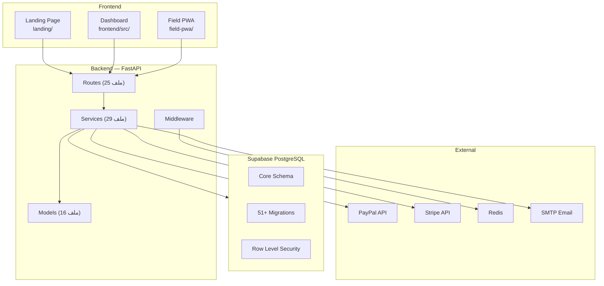
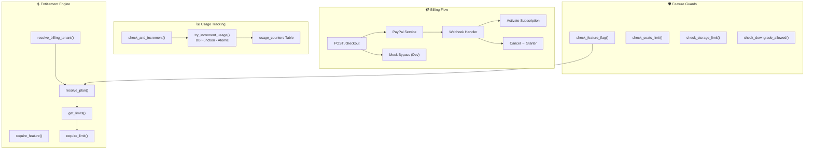
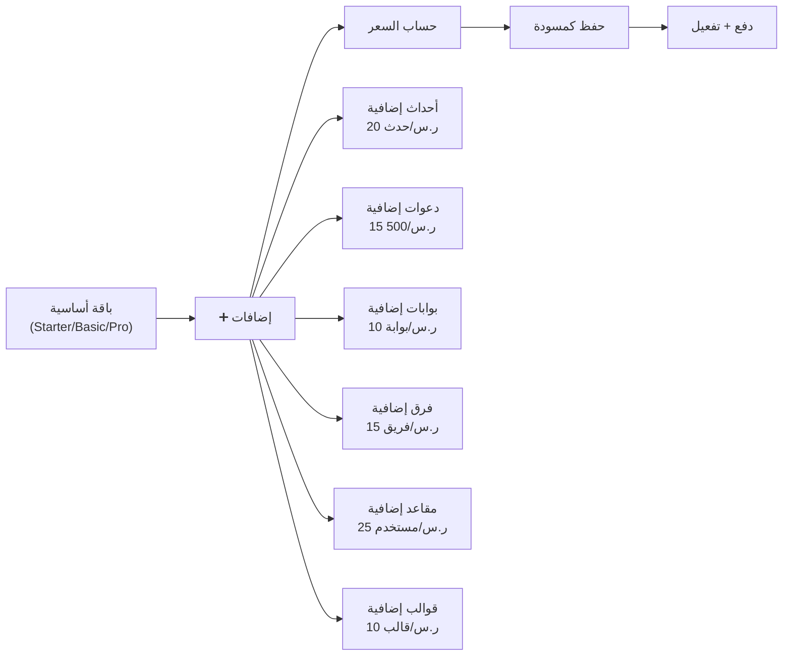
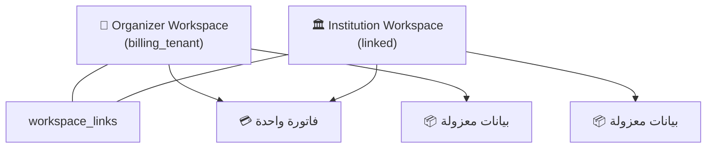

# 🏗️ تحليل احترافي شامل — منصة Qentry (دَعوة)

## نظرة عامة

**Qentry** هي منصة SaaS متعددة المستأجرين (Multi-Tenant) لإدارة الفعاليات والدعوات الرقمية، موجهة للسوق السعودي/الخليجي. المنصة تشمل نظام باقات واشتراكات احترافي من 5 مستويات مع دعم للباقات المخصصة.

| المكوّن | التقنية | الحالة |
|---------|---------|--------|
| Backend API | FastAPI (Python) + SQLAlchemy Async | ✅ متقدم |
| Database | Supabase (PostgreSQL) | ✅ 51+ migration |
| Frontend Dashboard | Vite + React + TypeScript + Tailwind | ✅ |
| Landing Page | HTML/CSS/JS ثابت | ✅ |
| Field PWA | تطبيق مسح QR للميدان | ✅ |
| Field Mobile | Expo + Flutter (تجريبي) | 🔄 |
| Payment Gateway | PayPal + Stripe (legacy) | ✅ |
| Auth | Supabase Auth + JWT | ✅ |

---

## 📊 هيكل المشروع



---

## 💎 نظام الباقات والاشتراكات — التحليل المفصّل

### 1. هرم الباقات (5 مستويات)


| الباقة | الشهري | السنوي | الخصم | الشعبية |
|--------|--------|--------|-------|---------|
| **Starter** | مجاني | مجاني | — | — |
| **Basic** | 200 ر.س | 1,920 ر.س | شهرين مجاناً | — |
| **Pro** | 500 ر.س | 4,800 ر.س | شهرين مجاناً | ⭐ الأكثر شعبية |
| **Business** | 1,200 ر.س | 11,500 ر.س | شهرين مجاناً | — |
| **Enterprise** | مخصص | مخصص | — | — |

### 2. حدود كل باقة (Plan Limits)

| المورد | Starter | Basic | Pro | Business | Enterprise |
|--------|---------|-------|-----|----------|------------|
| مستخدمو لوحة التحكم | 2 | 5 | 20 | 75 | ♾️ |
| أحداث شهرية | 1 | 3 | 10 | 50 | ♾️ |
| دعوات لكل حدث | 50 | 500 | 5,000 | 25,000 | ♾️ |
| دعوات شهرية | 100 | 1,500 | 10,000 | 75,000 | ♾️ |
| فرق العمل | 1 | 2 | 5 | 15 | ♾️ |
| أعضاء/فريق | 5 | 10 | 25 | 50 | ♾️ |
| قوالب مصممة | 1 | 3 | 10 | 30 | ♾️ |
| بوابات/حدث | 1 | 2 | 5 | 15 | ♾️ |
| ضيوف كحد أقصى | 200 | 2,000 | 10,000 | 50,000 | ♾️ |
| نماذج تسجيل | 1 | 1 | 1 | 1 | 1 |
| تخزين | 500 MB | 2 GB | 10 GB | 50 GB | 200 GB |
| رسائل شهرية | 100 | 500 | 5,000 | ♾️ | ♾️ |
| طلبات AI شهرية | 20 | 100 | 2,000 | 10,000 | ♾️ |

> [!IMPORTANT]
> **ملاحظة عن نماذج التسجيل**: جميع الباقات بما فيها Enterprise محددة بـ 1 نموذج فقط. هذا يبدو **خطأ متعمّد أو سهو** — الـ SQL migration v11 تضع `registration_forms_max = 1` لكل الباقات، بينما الميزات النصية في Pro و Business تذكر "نماذج تسجيل غير محدودة". يوجد **تعارض** بين `seed_plans.py` والـ migration.

---

### 3. الهندسة المعمارية للفوترة



#### مسار الاشتراك الكامل:

1. **المستخدم** يختار باقة → `POST /api/v1/subscriptions/checkout`
2. **التحقق من الأهلية**: `check_downgrade_allowed()` يمنع التنزيل إذا الاستخدام الحالي يتجاوز حدود الباقة الجديدة
3. **إنشاء خطة PayPal**: `PayPalService.create_billing_plan()` → تفعيل تلقائي
4. **إنشاء اشتراك PayPal**: يعود بـ `approval_url` للمستخدم
5. **تنفيذ الدفع**: `POST /api/v1/subscriptions/paypal/execute`
6. **إلغاء الاشتراكات السابقة** → إنشاء اشتراك جديد → تحديث `tenants.plan`
7. **Webhook Events**: `BILLING.SUBSCRIPTION.ACTIVATED`, `BILLING.SUBSCRIPTION.CANCELLED` إلخ.

---

### 4. نظام الباقات المخصصة (Custom Plan Builder)

هذا نظام متقدم يسمح للمستخدم ببناء باقة خاصة:



**الإضافات النشطة (6 من 13):**

| الإضافة | الخطوة | السعر/وحدة |
|---------|--------|-----------|
| أحداث شهرية | 1 | 20 ر.س |
| دعوات شهرية | 500 | 15 ر.س |
| بوابات/حدث | 1 | 10 ر.س |
| فرق العمل | 1 | 15 ر.س |
| مستخدمون | 1 | 25 ر.س |
| قوالب مصممة | 1 | 10 ر.س |

**القواعد:**
- الحد الأدنى للباقة المخصصة: **150 ر.س/شهر**
- السنوي = شهري × 10 (خصم شهرين)
- الكميات **فوق** حدود الباقة الأساسية فقط تُحسب كإضافات
- **الباقة المخصصة تُحفظ كمسودة** وتحتاج تفعيل من المنصة (بعد hardening)

> [!WARNING]
> **ثغرة أمنية مُعالَجة**: Migration v44 أضافت حقول `activated_at`, `activated_by`, `payment_reference`, `valid_until` وحوّلت الباقات المخصصة النشطة بدون إثبات دفع إلى `pending_review`. هذا يمنع التفعيل الذاتي بدون تحقق.

---

### 5. نظام الحقوق والصلاحيات (Entitlements)

المنصة تستخدم طبقة **مركزية** لتحديد الصلاحيات عبر [`entitlement_service.py`](file:///d:/QR/app/services/entitlement_service.py):

```
resolve_plan() يتبع هذا التسلسل:
  1. ✅ باقة مخصصة نشطة وصالحة (custom_plans)
  2. ✅ اشتراك نشط/تجريبي (subscriptions)  
  3. ⚠️ tenant.plan (fallback فقط إذا لا يوجد تاريخ اشتراكات)
  4. 🆓 Starter (fallback أخير)
```

**Feature Flags** — نظام مزدوج:

| الآلية | المصدر | الأولوية |
|--------|--------|---------|
| `feature_flags` table | تجاوز صريح per-tenant | أعلى |
| `included_by_tier` dict | hardcoded في feature_service.py | أدنى |

الميزات المحمية بالباقة:

| الميزة | Starter | Basic | Pro | Business | Enterprise |
|--------|---------|-------|-----|----------|------------|
| إرسال بريد | ✅ | ✅ | ✅ | ✅ | ✅ |
| RSVP | ❌ | ✅ | ✅ | ✅ | ✅ |
| WhatsApp | ❌ | ❌ | ✅ | ✅ | ✅ |
| تصدير PDF | ❌ | ❌ | ✅ | ✅ | ✅ |
| AI Features | ❌ | ❌ | ✅ | ✅ | ✅ |

---

### 6. نظام الحصص (Quota System)

طبقتان من التحقق:

#### أ) حصص على مستوى الباقة (Plan-Level)
- **عدادات شهرية** (`events_per_month`, `invitations_per_month`, `messages_per_month`): تُفرض عبر `try_increment_usage()` — **دالة PostgreSQL ذرّية** (atomic) تمنع race conditions
- **حدود ثابتة** (`seats_max`, `teams_max`, `guests_max`): تُفرض عبر `enforce_static_limit()`
- **تخزين** (`storage_mb`): يُحسب من `template_assets` + `usage_counters`

#### ب) حصص على مستوى الحدث (Event-Level)
- **VIP quota** + **Normal quota** لكل حدث
- قفل `pg_advisory_xact_lock` لمنع السباق المتزامن
- يُحسب بالأشخاص (guest_count) وليس بعدد الدعوات

---

### 7. Linked Workspaces — الفوترة المشتركة



- `resolve_billing_tenant()` يحدد أي tenant يملك الاشتراك
- `get_billing_scope_tenant_ids()` يُرجع كل workspaces المرتبطة
- **العدّادات** (seats, usage) تُجمع عبر كل الـ workspaces المرتبطة

---

## 🔐 الأمان والحماية

### طبقات الأمان:

| الطبقة | التنفيذ |
|--------|---------|
| **Authentication** | Supabase Auth + JWT verification |
| **Authorization** | RBAC (5 أدوار) + Permission keys |
| **Billing Permission** | `billing.view` / `billing.manage` |
| **Owner Guard** | `require_owner()` للإلغاء |
| **Rate Limiting** | Redis-backed middleware (120 req/min) |
| **Webhook Verification** | PayPal signature + Stripe signature |
| **CORS** | Whitelist + HTTPS enforcement (prod) |
| **Security Headers** | CSP, HSTS, X-Frame-Options |
| **Config Validation** | 20+ production safety checks |
| **Idempotent Webhooks** | `ON CONFLICT DO NOTHING` on `provider_event_id` |
| **Downgrade Guard** | يمنع التنزيل إذا الاستخدام يتجاوز الحدود |
| **Atomic Counters** | `try_increment_usage()` PostgreSQL function |

---

## ⚠️ المشاكل والملاحظات المكتشفة

### 🔴 مشاكل حرجة

1. **تعارض في حدود نماذج التسجيل**
   - [`seed_plans.py`](file:///d:/QR/seed_plans.py#L280) يضع `registration_forms_max = 1` لكل الباقات بما فيها Pro و Business
   - [Migration v11](file:///d:/QR/supabase/migration_v11_professional_plans.sql#L131) تذكر "نماذج تسجيل غير محدودة" في features نص Pro
   - **الأثر**: Pro و Business يدّعون "غير محدود" لكن الحد الفعلي = 1

2. **تاريخ ثابت في PayPal**
   - [`paypal_service.py:129`](file:///d:/QR/app/services/paypal_service.py#L129): `"start_date": "2025-01-01T00:00:00Z"` — تاريخ ثابت في الماضي!
   - **الأثر**: PayPal سيرفض أو يستخدم التاريخ الحالي ضمنياً

3. **صفحة التسعير (Landing) لا تتطابق مع الأسعار الفعلية**
   - [pricing.html](file:///d:/QR/landing/pricing.html#L89): "أساسي = 5,000 ر.س/شهر"
   - الباقة الفعلية (Basic): 200 ر.س/شهر
   - **الأثر**: تضليل الزوار — الأسعار في الـ landing page قديمة تماماً

### 🟡 مشاكل متوسطة

4. **Stripe legacy ما زال في الكود**
   - Webhook handler كامل لـ Stripe موجود رغم أن الدفع الأساسي = PayPal
   - `stripe.api_key` يُعيَّن عند import حتى لو فارغ

5. **تعارض بيانات seed_plans.py مع migration v11 SQL**
   - Seed script: `seats_max` للـ starter = 2, migration = 3
   - Seed script: Basic `events_per_month` = 3, migration = 5
   - Seed script: Basic `invitations_per_month` = 1500, migration = 1000
   - **الأثر**: يعتمد على أي ملف يُنفَّذ أخيراً

6. **`get_tenant_limits_summary()` لا تستخدم `resolve_billing_tenant()`**
   - [`feature_service.py:229`](file:///d:/QR/app/services/feature_service.py#L229) تستعلم مباشرة بـ `tenant_id` بدون الـ billing tenant
   - **الأثر**: في حالة linked workspaces، قد تُرجع بيانات خاطئة

7. **لا يوجد نظام إشعارات للحد الأقصى**
   - العدادات تُفرض فقط عند الطلب (429)
   - لا يوجد تحذير مسبق (80% مثلاً) ولا إشعار عبر البريد/Dashboard

### 🟢 ملاحظات تحسينية

8. **لا يوجد caching لنتائج `resolve_plan()`**
   - كل طلب يستعلم من الـ DB مباشرة (3-4 queries)
   - يمكن إضافة cache قصير (TTL 60s) في Redis

9. **لا يوجد دعم لكوبونات الخصم (Coupons/Promo Codes)**
   - مفيد جداً للسوق الخليجي

10. **Enterprise plan `price_monthly = 0`**
    - يجب أن يكون `NULL` أو حقل منفصل لتمييزه عن Starter (كلاهما 0)

11. **الأدوار الافتراضية مبنية يدوياً في `provision_tenant_manual()`**
    - 5 أدوار × صلاحيات = ~15 استعلام INSERT عند إنشاء كل tenant
    - يمكن تبسيطها بدالة PostgreSQL واحدة

---

## 📁 خريطة الملفات المتعلقة بالباقات

### Backend

| الملف | الوصف | الحجم |
|------|-------|-------|
| [`app/routes/subscriptions.py`](file:///d:/QR/app/routes/subscriptions.py) | جميع endpoints الباقات/الاشتراكات/الدفع | 914 سطر |
| [`app/services/entitlement_service.py`](file:///d:/QR/app/services/entitlement_service.py) | المصدر المركزي للحقوق | 147 سطر |
| [`app/services/feature_service.py`](file:///d:/QR/app/services/feature_service.py) | حراسة الميزات والحدود | 360 سطر |
| [`app/services/usage_service.py`](file:///d:/QR/app/services/usage_service.py) | تتبع الاستهلاك | 259 سطر |
| [`app/services/quota_service.py`](file:///d:/QR/app/services/quota_service.py) | حصص دعوات الأحداث | 193 سطر |
| [`app/services/paypal_service.py`](file:///d:/QR/app/services/paypal_service.py) | تكامل PayPal كامل | 293 سطر |
| [`app/services/provisioning_service.py`](file:///d:/QR/app/services/provisioning_service.py) | تهيئة المستأجر + Feature Flags | 422 سطر |
| [`app/models/plan.py`](file:///d:/QR/app/models/plan.py) | نماذج البيانات (Pydantic) | 132 سطر |
| [`app/models/subscription.py`](file:///d:/QR/app/models/subscription.py) | نموذج الاشتراك | 49 سطر |
| [`app/models/usage.py`](file:///d:/QR/app/models/usage.py) | نموذج الاستهلاك | 35 سطر |

### Database Migrations

| الملف | الوصف |
|------|-------|
| [`migration_v11_professional_plans.sql`](file:///d:/QR/supabase/migration_v11_professional_plans.sql) | نظام الباقات 5 مستويات + حدود |
| [`migration_v12_custom_plans.sql`](file:///d:/QR/supabase/migration_v12_custom_plans.sql) | الباقات المخصصة + الإضافات |
| [`migration_v13_limits_and_features.sql`](file:///d:/QR/supabase/migration_v13_limits_and_features.sql) | تحسينات حدود |
| [`migration_v14_addons_pricing.sql`](file:///d:/QR/supabase/migration_v14_addons_pricing.sql) | تحديث أسعار الإضافات |
| [`migration_v15_standard_plan_limits.sql`](file:///d:/QR/supabase/migration_v15_standard_plan_limits.sql) | توحيد الحدود |
| [`migration_v16_paypal_pending_subscriptions.sql`](file:///d:/QR/supabase/migration_v16_paypal_pending_subscriptions.sql) | جدول الاشتراكات المعلقة |
| [`migration_v44_billing_entitlement_hardening.sql`](file:///d:/QR/supabase/migration_v44_billing_entitlement_hardening.sql) | تشديد أمني + عدادات ذرية |

### Tests

| الملف | الوصف |
|------|-------|
| [`test_custom_plans.py`](file:///d:/QR/tests/test_custom_plans.py) | اختبارات الباقات المخصصة |
| [`test_downgrade_guard.py`](file:///d:/QR/tests/test_downgrade_guard.py) | اختبارات حماية التنزيل |
| [`test_plans_api.py`](file:///d:/QR/tests/test_plans_api.py) | اختبارات API الباقات |

---

## 📐 API Endpoints — الباقات والاشتراكات

| Method | Endpoint | الوصف | الصلاحية |
|--------|----------|-------|---------|
| `GET` | `/api/v1/plans` | عرض الباقات النشطة مع حدودها | عام |
| `GET` | `/api/v1/subscriptions/current` | الاشتراك الحالي | `billing.view` |
| `POST` | `/api/v1/subscriptions/checkout` | بدء عملية الدفع | `billing.manage` |
| `POST` | `/api/v1/subscriptions/paypal/execute` | تنفيذ بعد موافقة PayPal | `billing.manage` |
| `POST` | `/api/v1/subscriptions/cancel` | إلغاء الاشتراك | `billing.manage` + Owner |
| `POST` | `/webhooks/paypal` | PayPal webhooks | Signature verification |
| `POST` | `/webhooks/stripe` | Stripe webhooks (legacy) | Signature verification |
| `GET` | `/api/v1/addons` | عرض الإضافات المتاحة | عام |
| `POST` | `/api/v1/custom-plans/calculate` | حساب سعر باقة مخصصة (معاينة) | عام |
| `POST` | `/api/v1/custom-plans` | إنشاء باقة مخصصة | `billing.manage` |
| `GET` | `/api/v1/custom-plans` | عرض الباقات المخصصة | `billing.view` |
| `GET` | `/api/v1/custom-plans/active` | الباقة المخصصة النشطة | `billing.view` |

---

## 📈 إحصائيات المشروع

| المقياس | القيمة |
|---------|--------|
| إجمالي ملفات Backend | ~57 ملف Python |
| إجمالي Routes | 25 router module |
| إجمالي Services | 29 service module |
| إجمالي Models | 16 model file |
| إجمالي DB Migrations | 51+ migration |
| إجمالي Tests | 59 test file |
| Frontend Features | 19 feature module |
| API Version | v2.0.0 → v3.0.0 (health) |

---

## 🎯 خلاصة وتوصيات

### نقاط القوة ✅
- هندسة **Multi-tenant** ناضجة مع workspace linking
- نظام حقوق **Entitlement** مركزي يدعم custom plans + subscription fallback
- **عدادات ذرية** (atomic counters) تمنع race conditions
- **حماية التنزيل** (downgrade guard) ذكية
- تغطية اختبارات جيدة للـ billing flows
- تدقيق أمني شامل للإنتاج (20+ تحقق)

### أولويات التحسين 🔧
1. **عاجل**: مزامنة أسعار Landing page مع الباقات الفعلية
2. **عاجل**: إصلاح تعارض `registration_forms_max` (الحد vs الميزات النصية)
3. **عاجل**: إصلاح تاريخ PayPal الثابت
4. **مهم**: توحيد `seed_plans.py` مع migration SQL (مصدر واحد للحقيقة)
5. **تحسين**: إضافة نظام كوبونات خصم
6. **تحسين**: إضافة تنبيهات استهلاك (80%/100%)
7. **تحسين**: Cache لـ `resolve_plan()` في Redis
